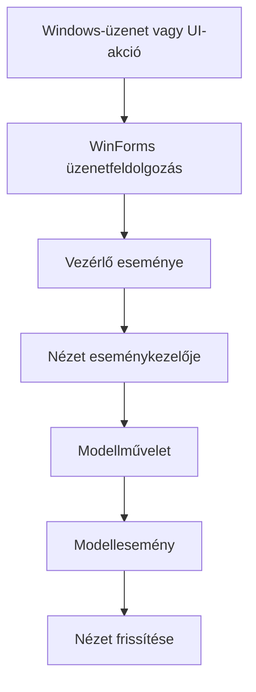
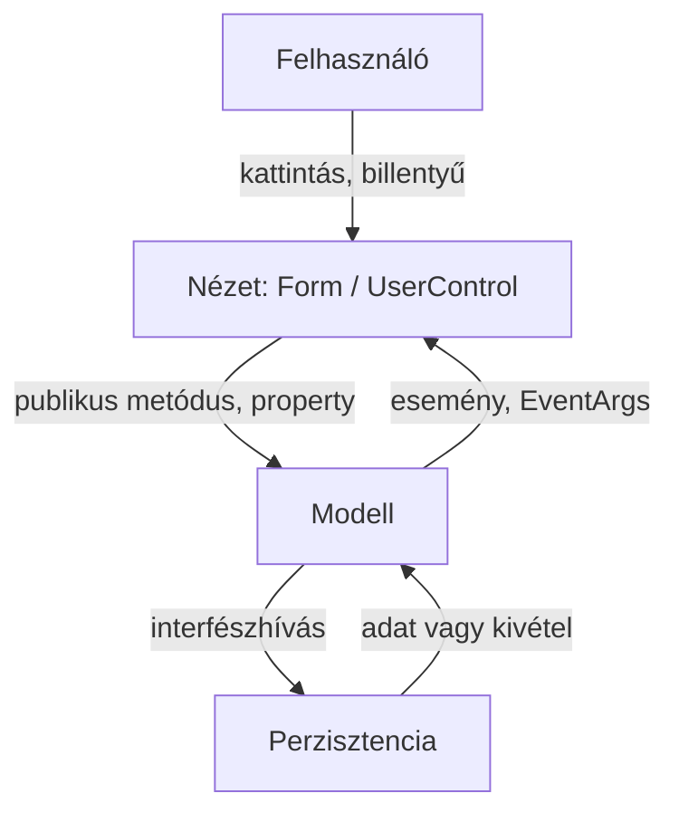

# Eseményvezérelt alkalmazások – teljes C# és WinForms tanulási jegyzet

Az `ANYAGOK.zip` előadásai, munkafüzetei, mintaprogramjai és két mintaZH-ja alapján.

**Használat:** először az 1–3. fejezetet használd kereshető referenciának, majd a 4. fejezettől haladj a tananyag sorrendjében. A főszöveg magyarázat és tanulási útmutató; a függelékek a források részletes, szerkeszthető szövegét és az összes C#-fájlt is megőrzik. A „kiegészítés” és „pontosítás” jelölés saját magyarázatot jelent, nem az oktatói forrás szó szerinti állítását.

**Forráskezelés:** a források különböző időpontokból és technológiai verziókból származnak. A bennük szereplő verziószámokat és kurzuskövetelményeket történeti, csomagbeli adatként kell olvasni. A jegyzet nem állítja, hogy ezek a mindenkori legújabb verziók vagy aktuális követelmények. A példák nem egyetlen összemásolható alkalmazás részei: a fejezetek külön kódrészleteket mutatnak.

## Tartalomjegyzék

1. [C#-szintaxis és alapkönyvtári referencia](#csharp)
2. [WinForms-kódreferencia](#winforms)
3. [WinForms-vezérlők, komponensek és fejlesztőeszközök](#tools)
4. [A tananyag térképe és a kurzus kerete](#terkep)
5. [.NET, C#, objektumorientált alapok és naming conventions](#alapok)
6. [0–1. gyakorlat: hibakeresés és konzolos DocuStat](#gy01)
7. [1. előadás és 2. gyakorlat: statikus felület, eseményvezérlés](#esemeny)
8. [2. előadás és 3. gyakorlat: MV-architektúra](#mv)
9. [3. előadás: dinamikus vezérlők, képek, elemi grafika](#dinamikus)
10. [4. előadás és 4. gyakorlat: perzisztencia, DI, factory, szerelvények](#perzisztencia)
11. [4. előadás és 5. gyakorlat: tesztelés](#teszt)
12. [5. előadás és 6. gyakorlat: szálak és aszinkron működés](#async)
13. [MintaZH: BlockDocu – részletes megoldási menet](#blockdocu)
14. [Második mintaZH: Gerrymandering](#gerry)
15. [ZH-munkamenet és ellenőrzőlista](#zh)
16. [Forráspéldák fejlődési térképe](#peldak)
17. [Pontosítások és gyakori hibák](#hibak)
<!-- 18. Függelékek: fájlleltár, előfordulási index, eredeti tananyag, teljes forráskód, bemeneti állományok, szemléltető forrásoldalak. -->

<a id="csharp"></a>
## 1. C#-szintaxis és alapkönyvtári referencia

A C# a nyelv; a WinForms, a LINQ, a fájlkezelés, a Moq és a tesztkeretrendszerek könyvtárak. Egy `Button` példányosítása C#-szintaxis, a `Button.Click` viszont könyvtári API. Az alábbi két referencia ezt a különbséget végig megtartja. Az összes tényleges forrássor megtalálható a teljes kódfüggelékben; a mechanikusan kigyűjtött taghivatkozások külön indexet kapnak.

### 1.1. Fájl, névtér, import, megjegyzés

| Alak | Jelentés, használat |
|---|---|
| `using System;` | Egy névtér típusainak rövid néven elérése; nem hoz létre projekthivatkozást. |
| `using System.Collections.Generic;` | Generikus gyűjtemények. |
| `using System.Linq;` | LINQ-bővítőmetódusok. |
| `using System.IO;` | Fájlok, adatfolyamok, útvonalak. |
| `using System.Threading;` / `System.Threading.Tasks` | Szálak, tokenek, taszkok. |
| `namespace ELTE.DocuStat.Model { ... }` | Logikai névcsoport. A mappa és a névtér összhangja konvenció. |
| `System.Windows.Forms.Timer` | Teljes típusnév, névütközés ellen. |
| `global::System.String` | Névfeloldás a globális névtérből; generált kódban is előfordul. |
| `// ...`, `/* ... */` | Egysoros és többsoros megjegyzés. |
| `/// <summary>...</summary>` | XML dokumentáció. További elemek: `param`, `returns`, `remarks`, `see`. |
| `#region Fields` / `#endregion` | Szerkesztőbeli tagolás, nem futási utasítás. |
| `#if`, `#define`, `#error`, `#line` | Az áttekintő előadás feltételes fordítást és fordítási direktívákat is tárgyal. |
| `[STAThread]`, `[TestClass]` | Metaadatot adó attribútum a deklaráció előtt. |

A `using` másik jelentése az erőforráskezelés; ezt ne keverd össze az importtal.

### 1.2. Típusok, literálok és értékadás

| Szintaxis | Mit jelent? Mire figyelj? |
|---|---|
| `bool`, `Boolean` | Logikai érték; `true`, `false`. |
| `sbyte`, `byte`, `short`, `ushort`, `int`, `uint`, `long`, `ulong` | Egész típusok; .NET-nevek: `SByte`, `Byte`, `Int16`, `UInt16`, `Int32`, `UInt32`, `Int64`, `UInt64`. |
| `float`, `double`, `decimal` | `Single`, `Double`, `Decimal`; eltérő pontosság és számábrázolás. A `decimal` nem azonos a `double` típussal. |
| `char c = 'a';` | Egy UTF-16 kódegység. |
| `string text = "Hello";` | Szöveg; referencia-típus, módosíthatatlan. |
| `object value = ...;` | Az általános alaptípusra hivatkozó változó. |
| `BigInteger` | A Fibonacci-példában nagy egész számok; `System.Numerics`. |
| `var count = 10;` | Fordításkor kikövetkeztetett, továbbra is rögzített típus. |
| `dynamic` | Az áttekintő előadásban futásidejű kötés; nem a `var` szinonimája. |
| `const int Size = 4;` | Fordítási idejű állandó. |
| `readonly Random _random = new Random();` | A mezőhivatkozás később nem cserélhető; a hivatkozott objektum változhat. |
| `new CalculatorModel()` | Konstruktorhívás, példányosítás. |
| `new Button { Text = "Új játék" }` | Objektuminicializáló. |
| `null` | Nincs hivatkozott objektum. |
| `string.Empty`, `""` | Üres szöveg, nem `null`. |
| `@"C:\Data\a.txt"` | Verbatim szöveg, a backslash nem escape. |
| `"C:\\Data\\a.txt"` | Ugyanennek hagyományosan escape-elt alakja. |
| `$"Pont: {points}"` | Szöveginterpoláció. |
| `$"{elapsed:F2}"` | Két tizedesjegy; `F0` egészre formázott megjelenítés. |
| `"\n"`, `"\t"` | Újsor és tabulátor. |

Az érték-típus másolása értéket másol, a referencia-típus változójának másolása hivatkozást. A tömb és a `List<T>` is referencia-típus. Az érték-típus élettartamát nem helyes általában „a blokk végéhez” kötni: lehet objektum mezője vagy dobozolt érték is.

### 1.3. Operátorok

| Csoport | Alakok | Példa, megjegyzés |
|---|---|---|
| Értékadás | `=`, `+=`, `-=`, `*=`, `/=` | Az `+=` eseménynél feliratkozás, számnál összeadás és visszaírás. |
| Aritmetika | `+`, `-`, `*`, `/`, `%`, `++`, `--` | Egész/egész osztás egész osztás: `(double)a / b` kell törthöz. |
| Összehasonlítás | `==`, `!=`, `<`, `>`, `<=`, `>=` | A `=` nem összehasonlítás. |
| Logikai | `!`, `&&`, `||` | A `&&` és `||` rövidzáras, ezért lehet előbb nullt vagy hosszt ellenőrizni. |
| Bitművelet, flag | `&`, `|` | `AnchorStyles.Top | AnchorStyles.Left`; billentyűmódosítók. |
| Feltételes | `condition ? a : b` | Két érték közötti választás. |
| Tagelérés | `.`, `[]`, `[,]` | Objektumtag, index, mátrixindex. |
| Nullbiztos elérés | `?.` | `Changed?.Invoke(this, EventArgs.Empty)`; ha null, nincs hívás. |
| Nullhelyettesítés | `??` | `Console.ReadLine() ?? ""`. |
| Null-forgiving | `!` a kifejezés után | `null!`, `(control as DocuStatControl)!`; csak a figyelmeztetést némítja el. |
| Típusművelet | `(T)x`, `is`, `as`, `typeof(T)`, `nameof(x)` | Konverzió, típusellenőrzés, biztonságos referenciakonverzió, típusobjektum, név. |
| Hátulról indexelés | `word[^1]` | Utolsó karakter; üres szövegnél érvénytelen. |
| Lambda / kifejezéstörzs | `=>` | Kontextustól függően függvénykifejezés vagy rövidített tagtörzs. |

### 1.4. Elágazás, ciklus és vezérlés

```csharp
if (model == null)
    return;
else if (model.StepNumber > 0)
    model.NewGame();

switch (e.KeyCode)
{
    case Keys.Add:
        PerformCalculation(Operation.Add);
        break;
    default:
        return;
}

for (int row = 0; row < table.GetLength(0); row++)
    for (int column = 0; column < table.GetLength(1); column++)
        table[row, column] = false;

while (history.Contains(number))
    number = random.Next(1, count + 1);

do
{
    success = int.TryParse(Console.ReadLine(), out number);
} while (!success);

foreach (var pair in statistics.FilteredWordCount)
{
    if (pair.Key.Length == 0)
        continue;
    Console.WriteLine($"{pair.Key}: {pair.Value}");
}
```

`return`: kilép a metódusból, szükség esetén eredménnyel. `break`: kilép a ciklusból vagy switch-ágból. `continue`: a következő cikluskörre lép. Az áttekintő a `goto`-t is említi switch-ág lezárásának lehetőségeként; a minták szokásos megoldása `break` vagy `return`.

A factory forráskódjában switch-kifejezés is van:

```csharp
public static IFileManager? CreateForPath(string path) =>
    Path.GetExtension(path) switch
    {
        ".txt" => new TxtFileManager(path),
        ".pdf" => new PdfFileManager(path),
        _ => null
    };
```

A `_` itt minden más esetre illeszkedő minta. A csomagbeli megoldás kiterjesztés-összehasonlítása kis- és nagybetűérzékeny; kiegészítésként `ToLowerInvariant()` használható.

### 1.5. Osztály, mező, tulajdonság, konstruktor, metódus

```csharp
public class CounterModel
{
    private int _count;
    public int Count => _count;
    public string Name { get; private set; } = string.Empty;
    public int Limit { get; init; }

    public CounterModel(string name)
    {
        Name = name;
    }

    public void Increment() { _count++; }
    public int Twice() => 2 * _count;
}
```

| Elem | Szerep |
|---|---|
| `public` | Külső felhasználók számára elérhető. |
| `private` | A tartalmazó típus belső részlete. |
| `protected` | A típus és leszármazottai számára. |
| `internal` | A szerelvényen belül. |
| `static` | A típushoz kötődik, nem külön példányhoz. |
| `partial class` | Több fájlban megadott egyetlen típus; a Form és a Designer kapcsolata. |
| `struct` | Érték szerint másolódó összetett típus. |
| `enum Operation { None, Add, Subtract, Multiply, Divide }` | Névvel ellátott diszkrét értékkészlet. |
| `get`, `set`, `value` | Lekérdezés, beállítás, a setternek átadott új érték. |
| `private set` | Kívülről olvasható, csak belül írható. |
| `init` | Inicializáláskor beállítható; az áttekintő tárgyalja. |
| `this` | Az aktuális objektum; `this[row, column]` indexelőnél külön jelentés. |
| `base(...)` | Az ős konstruktorának hívása. |
| `base.Method()` | Az ős megvalósításának hívása. |

A getter-only gyűjteménytulajdonság önmagában nem teszi írhatatlanná a gyűjteményt: a `public List<int> Data { get; }` értékén a `Clear()` továbbra is hívható. Ezért a DocuStat `IReadOnlyDictionary` felületet ad kifelé. Ez az API-n keresztüli módosítást korlátozza, nem hoz létre automatikusan megváltoztathatatlan másolatot.

### 1.6. Öröklődés, interfész, polimorfizmus

```csharp
public interface IFileManager
{
    string Load();
}

public class TxtFileManager : IFileManager
{
    public string Load() => File.ReadAllText(_path);
    private readonly string _path;
    public TxtFileManager(string path) { _path = path; }
}

public class FileManagerException : IOException
{
    public FileManagerException(string message, Exception inner)
        : base(message, inner) { }
}
```

A C#-osztálynak legfeljebb egy közvetlen ősosztálya, de több interfésze lehet. `virtual`: felüldefiniálható megvalósítás; `abstract`: kötelezően megvalósítandó tag, illetve nem példányosítható osztály; `override`: valódi felüldefiniálás; `sealed`: további öröklődés/felüldefiniálás lezárása. A `new` tagmódosító elrejtést jelent, eltér az `override` működésétől. Őstípusú változón a virtuális hívás a tényleges objektum megvalósítását használja, az elrejtett nem virtuális tag kiválasztása a statikus típustól függ.

Az áttekintő az interfészt „tisztán absztrakt osztályként” magyarázza. Tanulási szempontból pontosabb szerződésként kezelni: milyen tagokat kell a megvalósításnak szolgáltatnia. Az interfész és az osztály nem azonos nyelvi kategória.

### 1.7. Paraméterek és generikus típusok

| Alak | Jelentés |
|---|---|
| `void M(int x)` | Alapértelmezett érték szerinti átadás; referencia-típusnál a hivatkozás értéke másolódik. |
| `ref int x` | Meglévő változó cím szerinti átadása. |
| `out int x` | A metódus kimenő értéket ír; `TryParse` használja. |
| `params T[] values` | Változó számú argumentum; az áttekintőben. |
| `int count = 1` paraméterben | Alapértelmezett argumentum; az áttekintőben. |
| `M(count: 3)` | Név szerinti argumentum; az áttekintőben. |
| `List<T>`, `EventHandler<TEventArgs>`, `Task<T>` | Típusparaméteres szerkezetek. |
| `where T : struct, IComparable, ...` | Generikus megszorítások; az áttekintőben. |

### 1.8. Tömbök, listák és lekérdezések

```csharp
int[] values = new int[] { 1, 2, 3 };
Player[,] board = new Player[3, 3];
Button[,] buttons = new Button[4, 4];
List<int> history = new List<int>();
Dictionary<string, int> counts = new Dictionary<string, int>();

history.Add(2);
history.Insert(0, 1);
history.Remove(2);     // érték szerint
history.RemoveAt(0);   // index szerint
history.Clear();
bool known = counts.ContainsKey("alma");
counts["alma"] = 3;
```

| Tag / típus | Szerep |
|---|---|
| `Length`, `GetLength(d)`, `Rank` | Teljes elemszám, adott dimenzió hossza, dimenziószám. |
| `Count` | Lista, szótár, gyűjtemény elemszáma. |
| `Array.Copy`, `Resize`, `Sort`, `Reverse`, `Find`, `IndexOf`, `LastIndexOf`, `BinarySearch` | Az áttekintő tömbműveletei. |
| `IEnumerable<T>` | Bejárható sorozat. |
| `IList<T>`, `IReadOnlyCollection<T>`, `IReadOnlyDictionary<K,V>` | Különböző képességű felületek. |
| `KeyValuePair<K,V>.Key`, `.Value` | Szótár bejárásának elemei. |
| `Stack<T>`, `Queue<T>`, `LinkedList<T>` | Verem, sor, láncolt lista. |
| `HashSet<T>`, `SortedSet<T>` | Halmazok. |
| `SortedList`, `SortedDictionary` | Rendezett tárolók. |
| `ArrayList`, `Hashtable` és nem generikus változatok | A diákban szereplő régebbi gyűjtemények; a generikus típusok előnyösebbek. |

```csharp
public Player this[int row, int column]
{
    get
    {
        if (row < 0 || row >= 3 || column < 0 || column >= 3)
            throw new ArgumentException("Invalid position.");
        return _gameTable[row, column];
    }
}
```

A kétdimenziós tömb `board[row, column]`, a táblapanel `Controls.Add(control, column, row)`: a két argumentumsorrend eltér.

### 1.9. Lambda, anonim delegált és LINQ

```csharp
Func<int, int> square = x => x * x;
Action<int> print = value => Console.WriteLine(value);
model.GameOver += delegate(object? sender, EventArgs e) { finished = true; };
model.GameOver += (sender, e) => finished = true;

var filtered = counts
    .Where(p => p.Key.Length >= minimumLength)
    .Where(p => p.Value >= minimumOccurrence)
    .Where(p => !ignoredWords.Contains(p.Key))
    .OrderByDescending(p => p.Value);

var query = from pair in counts
            where pair.Value >= minimumOccurrence
            orderby pair.Value descending
            select pair;
```

| Metódus | Mire használja az anyag? |
|---|---|
| `Where(predicate)` | Szűrés. |
| `Select(selector)` | Minden elem átalakítása, például szám szövegből, byte-ból enum. |
| `OrderByDescending(selector)` | Csökkenő rendezés előfordulásszám szerint. |
| `Sum(selector)`, `Count(predicate)` | Összegzés, feltételes számlálás. |
| `Contains(value)`, `ContainsKey(key)` | Elem, illetve szótárkulcs vizsgálata. |
| `ElementAt(index)` | Sorozatelem lekérése. |
| `SkipWhile(predicate)`, `Reverse()` | Szóvégi és szóeleji írásjelek levágása. |
| `ToArray()`, `ToList()` | Anyagiasítás konkrét gyűjteménnyé. |
| `SequenceEqual(other)` | Az elemek és sorrend összehasonlítása. |
| `Union(other)` | Ismétlődés nélküli unió. |
| `Enumerable.Repeat(value, n)` | Mockolt üres játéktábla előállítása. |

Sok LINQ-lekérdezés késleltetett: csak bejáráskor fut. A `ToArray()` pillanatnyi eredményt állít elő. A `Select(x => x % 2 == 0)` **logikai értékek sorozatát** adja, nem a páros számokat; a kiválogatáshoz `Where` kell.

### 1.10. Szöveg, konverzió, matematika, idő

| API | Használat, buktató |
|---|---|
| `int.TryParse(text, out number)` | Hibás bevitelnél `false`; nem dob formátumhibát. |
| `Int32.Parse`, `Double.Parse`, `Convert.ToInt32`, `ToDouble`, `ToString` | Konverzió; a formátum és a kultúra számíthat. |
| `string.Length`, indexelő, `Split`, `Remove`, `Trim`, `ToLower`, `EndsWith`, `Replace`, `Substring` | A szövegfeldolgozó példák alapműveletei. A módosítók új stringet adnak. |
| `String.IsNullOrEmpty`, `String.Concat` | Ürességellenőrzés és karakterek/szövegek összefűzése. |
| `char.IsLetter`, `IsUpper`, `IsWhiteSpace`, `ToLower` | Betű, nagybetű, elválasztó, kisbetűsítés. |
| `StringBuilder.Append`, `.ToString()` | Sok szövegrész hatékony összegyűjtése. |
| `Random.Next(min, max)` | `min` benne van, `max` nincs benne. |
| `Math.Max`, `Math.Min`, `Math.Abs` | Korlát, koordináták és méretek kezelése. |
| `DateTime.Now`, `.AddHours`, `.Second`, `.ToString("HH:mm")` | Óra és időzónás kijelzés a gyakorlatban. |
| `DateTime - DateTime`, `TimeSpan.TotalSeconds` | Eltelt idő. |
| `Double.NaN`, `PositiveInfinity`, `Int32.MaxValue` | Speciális értékek a diákban. |

A `Convert.ToInt32(decimal)` kerekíthet; a `(int)decimalValue` levágja a törtrészt. A NumericUpDown egészlépéses felhasználásánál a beállításokat is ehhez igazítsd.

### 1.11. Kivétel és erőforrás

```csharp
try
{
    using StreamReader reader = new StreamReader(path);
    string content = reader.ReadToEnd();
}
catch (IOException ex)
{
    MessageBox.Show(ex.Message);
}
finally
{
    // például a letiltott felületi gomb visszakapcsolása
}

throw new ArgumentOutOfRangeException(nameof(row));
```

`throw;` az aktuális kivétel továbbdobása; `throw new ...` új kivétel; becsomagolásnál őrizd az eredetit `innerException` formában. Az anyagban szerepel többek között `ArgumentException`, `ArgumentNullException`, `ArgumentOutOfRangeException`, `InvalidOperationException`, `IOException`, `DataException` és `FileManagerException`.

`using (var resource = ...) { ... }`: a blokk végén `Dispose`. `using var resource = ...;`: a tartalmazó hatókör végén `Dispose`. A `using (resource);` **üres utasítástörzs**, nem ennek megfelelő rövidítés. A GC nem helyettesíti a fájlok, időzítők és rajzeszközök determinisztikus lezárását.

### 1.12. Esemény, async és tesztszintaxis – gyorslap

| Szintaxis / API | Jelentés |
|---|---|
| `public event EventHandler? Changed;` | Adat nélküli értesítés. |
| `event EventHandler<MyEventArgs>? Changed;` | Típusos adatot hordozó értesítés. |
| `source.Changed += Handler;` | Feliratkozás; a metódust adod át, nem `Handler()`-t hívsz. |
| `source.Changed -= Handler;` | Leiratkozás ugyanazzal a delegálttal. |
| `Changed?.Invoke(this, EventArgs.Empty);` | Biztonságos kiváltás a deklaráló típuson belül. |
| `delegate void HandlerType(object? sender, EventArgs e);` | Metódusaláírást leíró típus. |
| `async Task<T> MethodAsync()` | Beváható aszinkron eredmény. |
| `await task` | Nem blokkoló bevárás a metódusban. |
| `Task.Run(() => Compute())` | Számítás ütemezése a szálkészletre. |
| `Task.WhenAll(tasks)` | Több művelet együttes bevárása. |
| `Task.Result`, `Wait`, `WaitAll`, `Thread.Join` | Blokkolnak; UI-szálon problémásak. |
| `CancellationTokenSource`, `.Cancel()`, `IsCancellationRequested` | Együttműködésen alapuló megszakítás. |
| `lock (_sync) { ... }` | Kritikus szakasz kölcsönös kizárással. |
| `Interlocked.Increment(ref count)` | Atomi növelés. |
| `[TestClass]`, `[TestMethod]`, `[TestInitialize]`, `[DataRow]` | MSTest. |
| `[Fact]`, `[Theory]`, `[InlineData]` | xUnit. |
| `[TestFixture]`, `[Test]`, `[SetUp]`, `[TestCase]` | NUnit. |
| `new Mock<IFileManager>()`, `.Setup(...)`, `.Returns(...)`, `.Throws(...)` | Moq-függőséghelyettesítés. |
| `.Verify(..., Times.Once())` | A hívás tényleges megtörténtének ellenőrzése. |

<a id="winforms"></a>
## 2. WinForms-kódreferencia

### 2.1. Belépési pont és ablak

```csharp
[STAThread]
static void Main()
{
    ApplicationConfiguration.Initialize();
    Application.Run(new MainForm());
}

public partial class MainForm : Form
{
    public MainForm()
    {
        InitializeComponent();
        // A Designerben készített vezérlők most már léteznek.
        newGameButton.Click += NewGameButton_Click;
    }

    private void NewGameButton_Click(object? sender, EventArgs e)
    {
        _model.NewGame();
    }
}
```

`Application.Run`: elindítja az üzenetfeldolgozást és a főablakot. `Close()`: az adott ablakot zárja; a főablak lezárása a szokásos indítási mintában befejezi a programot. `Application.Exit()`: alkalmazásszintű kilépés. `Show()`: nem modális ablak. `ShowDialog()`: modális dialógus, eredménye `DialogResult`.

Az előadás további Application-tagokat is említ: `SetHighDpiMode`, `EnableVisualStyles`, `UseWaitCursor`, `StartupPath`, `OpenForms`, `ProductName`, `ApplicationExit`, `Idle`. A régebbi explicit indítási beállításokat ne másold gondolkodás nélkül az új sablon inicializálása mellé.

### 2.2. Általános vezérlőtulajdonságok

| Tag | Mire való? Mire figyelj? |
|---|---|
| `Name` | Kódbeli azonosító; nem a felirat. |
| `Text` | Megjelenített felirat/szöveg. |
| `Location = new Point(x, y)` | Pozíció a szülő klienskoordinátái szerint. |
| `Size = new Size(w, h)`, `Width`, `Height` | Vezérlőméret. |
| `ClientSize` | Az ablak tényleges belső területe; nem tartalmazza a címsort/keretet. |
| `MinimumSize` | Megakadályozza a használhatatlanul kicsi ablakot. |
| `Dock = DockStyle.Fill` | A szülő szabad területének kitöltése. További értékek: `Top`, `Bottom`, `Left`, `Right`, `None`. |
| `Anchor = AnchorStyles.Top | AnchorStyles.Left` | A megadott szélektől tartott távolság. |
| `AutoSize`, `AutoSizeMode` | Tartalomhoz igazodás; fix cellaméretnél gondold át. |
| `Margin`, `Padding` | Külső és belső térköz; rácsban a hézagokat is befolyásolja. |
| `Enabled`, `Visible` | Használhatóság és megjelenés. |
| `Focused`, `Focus()` | Fókusz lekérdezése, illetve kérése. |
| `BackColor`, `ForeColor`, `Font` | Háttér, szövegszín, betű. |
| `TabIndex`, `TabStop` | Billentyűzetes fókuszbejárás. |
| `Controls.Add`, `Remove`, `Clear` | Szülő–gyerek kapcsolat; `Clear` nem azonos a `Dispose`-zal. |
| `SuspendLayout()`, `ResumeLayout()`, `PerformLayout()` | A generált Designer-kód elrendezési költségét csökkentik. |
| `Invalidate()`, `Refresh()` | Újrarajzolás kérése, illetve azonnalibb frissítés. |
| `Dispose()` | Erőforrások elengedése. |

A Designer további szokásos beállításai, például `AutoScaleMode`, `AutoScaleDimensions`, `UseVisualStyleBackColor`, `ISupportInitialize.BeginInit/EndInit` a teljes forráskódban, eredeti helyükön szerepelnek. Ezeket rendszerint a tervező kezeli.

### 2.3. Ablak- és bemeneti események

| Esemény | Argumentum / használat |
|---|---|
| `Load` | Kezdőállapot megjelenítése a felület betöltésekor. |
| `FormClosing` | `FormClosingEventArgs`, `CloseReason`, `Cancel`. |
| `Resize`, `SizeChanged` | Rácsméret és rajzfelület újraszámítása. |
| `Paint` | `PaintEventArgs.Graphics`: ebből rajzolj. |
| `Click` | `EventArgs`; egérgomb és koordináta nélküli általános aktiválás. |
| `MouseClick`, `MouseDoubleClick`, `MouseDown`, `MouseUp`, `MouseMove` | `MouseEventArgs`: `X`, `Y`, `Location`, `Button`. |
| `MouseWheel` | `MouseEventArgs.Delta`: görgetés mértéke. |
| `MouseEnter`, `MouseHover`, `MouseLeave` | Belépés, fölötte tartózkodás, kilépés. |
| `PreviewKeyDown`, `KeyDown`, `KeyUp` | Billentyű; többek között `KeyCode`, `KeyData`, `Modifiers`. |
| `KeyPress` | Karakterbevitel; nem azonos a fizikai billentyűk kezelésével. |
| `TextChanged`, `ValueChanged`, `CheckedChanged` | Szöveg, szám vagy kijelölés változott. |
| `Validating`, `Validated`, `GotFocus` | Érvényesítés és fókusz. |
| `BackColorChanged`, `TabIndexChanged` | Tulajdonságváltozás; a diák példái. |

```csharp
KeyPreview = true;
KeyDown += Form_KeyDown;

private void Form_KeyDown(object? sender, KeyEventArgs e)
{
    if (e.KeyCode == Keys.N && e.Modifiers == Keys.Control)
    {
        _model.NewGame();
        e.SuppressKeyPress = true;
    }
}
```

### 2.4. Rács és listák

```csharp
table.RowCount = size;
table.ColumnCount = size;
table.RowStyles.Clear();
table.ColumnStyles.Clear();
for (int i = 0; i < size; i++)
{
    table.RowStyles.Add(new RowStyle(SizeType.Percent, 100f / size));
    table.ColumnStyles.Add(new ColumnStyle(SizeType.Percent, 100f / size));
}

for (int row = 0; row < size; row++)
    for (int column = 0; column < size; column++)
    {
        var button = new GridButton(row, column) { Dock = DockStyle.Fill };
        button.Click += GridButton_Click;
        table.Controls.Add(button, column, row);
    }

listBox.BeginUpdate();
try
{
    listBox.Items.Clear();
    foreach (var pair in model.FilteredWordCount)
        listBox.Items.Add($"{pair.Key}: {pair.Value}");
}
finally { listBox.EndUpdate(); }
```

`GridButton` saját `Button`-leszármazott a rácskoordinátákkal. A ciklusváltozó lambda általi elfogásánál készíts külön lokális másolatot, vagy használd ezt a saját típust; különben minden gomb rossz koordinátát kaphat.

### 2.5. Dialógus, időzítő, kép, szálra visszatérés

```csharp
using OpenFileDialog dialog = new OpenFileDialog();
dialog.Filter = "Text files (*.txt)|*.txt|PDF files (*.pdf)|*.pdf";
dialog.Multiselect = true;
if (dialog.ShowDialog(this) == DialogResult.OK)
{
    foreach (string path in dialog.FileNames)
    {
        // A modell/perzisztencia dolgozza fel a fájlt.
    }
}

var timer = new System.Windows.Forms.Timer();
timer.Interval = 1000; // ezredmásodperc
timer.Tick += Timer_Tick;
timer.Start();
// timer.Stop(); timer.Enabled; timer.Dispose();

pictureBox.SizeMode = PictureBoxSizeMode.StretchImage;
pictureBox.Image = Image.FromFile(path);

if (InvokeRequired)
{
    BeginInvoke(new Action(() => UpdateStatistics(sender, e)));
    return;
}
// Innen a UI-szálon szabad felületi tulajdonságokat állítani.
```

A tényleges `UpdateStatistics` aláírásának illeszkednie kell az eseményargumentumhoz. A képek lecserélésekor a tulajdonolt régi `Image` erőforrását is engedd el. Közösen használt beágyazott képet ne szabadíts fel úgy, hogy más vezérlő még használja.

<a id="tools"></a>
## 3. WinForms-vezérlők, komponensek és fejlesztőeszközök

### 3.1. Ténylegesen példányosított felületi elemek

A következő táblázat a csomag forráskódjaiban létrehozott felületi típusokat foglalja össze. Az előadásban csak említett típusok külön táblázatban következnek.

| Vezérlő / komponens | Mire használjuk? | Fontos kód, figyelmeztetés |
|---|---|---|
| `Form` | Főablak, beállítóablak. | `InitializeComponent`, `Load`, `Show/ShowDialog`, `Close`; a modális ablakot tulajdonossal érdemes nyitni. |
| `Button` | Művelet, játékmező, számológép-gomb. | `Click`, `Text`, `Enabled`, `BackColor`; a szabályt a modell dönti el. |
| `GridButton` | Saját gomb rácsbeli koordinátával. | `GridX`, `GridY`; tisztázd, melyik a sor és az oszlop. |
| `Label` | Metrikák, város, idő, feliratok. | `Text`, `AutoSize`, `Image`, `Font`; hosszú számok ne lógjanak le. |
| `TextBox` | Számbevitel, fájlszöveg, kizárt szavak. | `TextChanged`, `Multiline`, `ReadOnly`, `ScrollBars`, `WordWrap`; programozott értékadás is kiváltja az eseményt. |
| `NumericUpDown` | Méret, szóhossz, előfordulás, tételszám. | `Value` decimal; `Minimum`, `Maximum`, `Increment`, `ValueChanged`; előbb állíts érvényes tartományt. |
| `ListBox` | Számítási előzmények, szóstatisztika, Fibonacci-eredmények. | `Items.Add/Insert/Clear`, `BeginUpdate/EndUpdate`; ezek nem szál-szinkronizációs műveletek. |
| `CheckedListBox` | Kiadott tételek kiválasztása és visszaadása. | `Items`, `CheckedItems`, `SetItemChecked`; a kijelölés és bepipálás külön fogalom. |
| `RadioButton` | Rajzolt alakzat típusa. | `Checked`; egy szülőn belül kizáró választás. |
| `GroupBox` | Összetartozó vezérlők, rádiógombcsoport. | `Controls`, `Text`; a rádiógombok szülője számít. |
| `Panel` | Rajzfelület vagy egyszerű konténer. | `Paint`, `MouseDown/Move/Up`, `Refresh`; a rajzot az adatokból újra elő kell tudni állítani. |
| `FlowLayoutPanel` | Digitális órák és sorban elhelyezett elemek. | `FlowDirection`, `Dock`, `Controls.Add`; a panel rendezi a gyermekeket. |
| `TableLayoutPanel` | Színezős gombrács, dinamikus tábla. | `RowCount`, `ColumnCount`, `RowStyles`, `ColumnStyles`, `Controls.Add(c, column, row)`; a stílusokat is kezeld. |
| `PictureBox` | Képkockák, előnézet, képek. | `Image`, `SizeMode`, `ImageLocation`, `ErrorImage`; az aránytartáshoz `Zoom` hasznos kiegészítés, a mintában nyújtás is van. |
| `MenuStrip` | Főmenü. | `Items`, ablak `MainMenuStrip`; az almenük nem a Form.Controls-ba kerülnek. |
| `ToolStripMenuItem` | Megnyitás, mentés, új játék, szűrő-visszaállítás. | `DropDownItems`, `Click`, `ShortcutKeys`, `Enabled`; a munkafüzet „MenuItem” szava itt ezt jelenti. |
| `ToolStripSeparator` | Menüelemek vizuális elválasztása. | Nem parancs, általában nincs üzleti eseménykezelője. |
| `StatusStrip` | Állapotsor. | `Items`; magasságát vond le a gombvadászat szabad területéből. |
| `ToolStripStatusLabel` | Pont és eltelt idő az állapotsorban. | `Text`; nem a hagyományos Label típus. |
| `TabControl` | Több megnyitott dokumentum. | `TabPages`, `SelectedTab`; üres állapotban lehet null a kiválasztott lap. |
| `TabPage` | Egy dokumentum saját lapja. | `Text`, `Controls.Add`; a saját vezérlő kapjon megfelelő `Dock` értéket. |
| `ProgressBar` | Elemzés százalékos előrehaladása. | `Minimum`, `Maximum`, `Value`, `Visible`; az érték legyen tartományon belül, háttérszálról marshaling kell. |
| `UserControl`, `Clock`, `DocuStatControl` | Újrafelhasználható összetett felület. | Saját `.Designer.cs`; konstruktorban `InitializeComponent`; a modell és a UI továbbra is külön felelősség. |
| `OpenFileDialog` | TXT/PDF és játékállás kiválasztása. | `Filter`, `InitialDirectory`, `RestoreDirectory`, `FileName/FileNames`, `Multiselect`; a kiválasztás még nem beolvasás. |
| `SaveFileDialog` | Mentési útvonal kiválasztása. | `Filter`, `FileName`, `ShowDialog`; csak `OK` után ments. |
| `FolderBrowserDialog` | Képkockákat tartalmazó könyvtár. | `SelectedPath`, `ShowDialog`; üres vagy hibás képmappa is előfordulhat. |
| `System.Windows.Forms.Timer` | UI-frissítés, óra, animáció. | `Interval`, `Tick`, `Start/Stop`, `Enabled`; UI-szálon fut, hosszú feladat nem való bele. |
| `MessageBox` | Hiba, eredmény, megerősítés. | Statikus `Show`; `MessageBoxButtons`, `MessageBoxIcon`, `DialogResult`; a modellből ne hívd. |

A `ToolStripItem` a menü- és státuszelemek közös alaptípusa; a Designer `ToolStripItem[]` tömböt is készít az `AddRange` híváshoz. A `RowStyle`, `ColumnStyle`, `Point`, `Size`, `Padding`, `Font`, `Color` segédtípusok, nem önálló, képernyőre húzható vezérlők.

### 3.2. Az előadásban említett további vezérlők és dialógusok

| Típus | Mire való? | Mire figyelj? |
|---|---|---|
| `CheckBox` | Független igen/nem választás. | `Checked`, `CheckedChanged`; eltér a kizáró rádiógombcsoporttól. |
| `ComboBox` | Legördülő választó. | `Items`, `SelectedItem`, `SelectedIndexChanged`; döntsd el, lehessen-e saját szöveget írni. |
| `ListView` | Összetettebb listamegjelenítés. | Nézetmód, oszlopok és elemek együtt alakítják a megjelenést. |
| `ToolStrip` | Eszköztár. | `Items` kollekció; a MenuStrip és StatusStrip rokon rendszert használ. |
| `FontDialog` | Betűtípus választása. | `ShowDialog` után `Font`; `OK` ellenőrzése. |
| `ColorDialog` | Színválasztás. | `Color`; a felhasználó megszakíthatja. |
| `PrintDialog` | Nyomtató és nyomtatási beállítások. | Nyomtatási dokumentumot is hozzá kell kapcsolni. |
| `PrintPreviewDialog` | Nyomtatási előnézet. | Nem automatikus képernyőkép a Formról. |
| `PageSetupDialog` | Papír, margók és oldalbeállítás. | A nyomtatási folyamat része. |

A dián látható öröklési hierarchia további alaptípusai: `Control`, `ButtonBase`, `ListControl`, `ScrollableControl`, `ContainerControl`. A hierarchia azt magyarázza, miért vannak közös tulajdonságok és események.

### 3.3. Visual Studio és projektkezelő eszközök

| Eszköz / művelet | Használat |
|---|---|
| Solution Explorer | Projektek és fájlok; egy solution több projektből állhat. |
| Designer | Vezérlők felhelyezése és elrendezése; kódot generál. |
| Toolbox | Vezérlők drag-and-drop elhelyezése. Saját UserControlhoz előbb fordítás kellhet. |
| Properties | A kijelölt vezérlő tulajdonságai; villám ikon alatt események. |
| View Code / View Designer | Saját kód és grafikus terv közötti váltás. |
| Add Existing Project | Meglévő projekt felvétele a solutionbe. |
| Add Project Reference | Típusok elérhetővé tétele másik projektből; a `using` ezt nem pótolja. |
| Set as Startup Project | Melyik futtatható projekt induljon. |
| Manage NuGet Packages | iText, Moq, tesztkeretrendszer, DI-csomagok. A csomagokat a megfelelő projekt kapja. |
| Test Explorer / Run Test / Debug Test | Tesztfuttatás és teszten belüli hibakeresés. |
| Breakpoint, Step Into/Over, Watch, Call Stack | Kiegészítő hibakeresési fogások: ellenőrizd az állapotot és a hívási utat. |
| Build / Rebuild | Fordítás és típushibák ellenőrzése; UI-futtatás előtt is fontos. |

Egyedi vezérlőtulajdonságoknál a forrás `Category`, `Description`, `DesignerSerializationVisibility` attribútumokat használ; a `Browsable(false)` elrejtheti a tulajdonságot a Properties panelről. A tervező szerializációs elvárásait a projekt célverziójával együtt kell értelmezni.

<a id="terkep"></a>
## 4. A tananyag térképe és a kurzus kerete

A csomag két párhuzamos tanulási szálat tartalmaz. Az előadások a számológép–TicTacToe–grafika példasoron keresztül építkeznek, a gyakorlatok a tombola után főként a dokumentumstatisztikát fejlesztik tovább. A következő sorrend ezeket a közös fogalmi állomásoknál kapcsolja össze; az eredeti előadás- és gyakorlat-sorrend a függelékben külön is megmarad.

| Állomás | Előadás | Gyakorlat | Kimenet |
|---|---|---|---|
| Alapozás | 0. C# és .NET | 0. tombola, 1. konzolos DocuStat | Nyelv, hibakezelés, fájl, LINQ. |
| Első grafikus program | 1. WinForms, események | 2. Quit, ButtonHunt, DigiClock | Vezérlő és eseménykezelő. |
| Feladatok szétválasztása | 2. MV | 3. grafikus DocuStat | Modell parancsokkal és eseményekkel. |
| Dinamikus felület | 3. rács, képek, rajzolás | A korábbi felület bővítése | Futás közben létrehozott elemek, Paint. |
| Tartós tárolás | 4. architektúra első része | 4. TXT/PDF, factory, DI | Cserélhető perzisztencia. |
| Ellenőrzés | 4. tesztelés | 5. MSTest, xUnit, Moq | Automatikusan ellenőrzött modell. |
| Reszponzivitás | 5. párhuzamosítás | 6. több lap, async, progress | Háttérfeldolgozás és UI-szinkronizáció. |
| Önálló alkalmazás | Két mintaZH | Részfeladatonkénti megvalósítás | Tervezés, implementáció, ellenőrzés. |

A bevezető célja: objektumorientált C#/.NET, grafikus eseményvezérelt alkalmazások és rétegezett architektúrák megismerése. Előfeltételként objektumelvű programozást, UML-t, adatszerkezeteket és elemi algoritmusokat nevez meg. A tágabb kurzus WinForms, WPF és Avalonia UI környezetet is tárgyal, de a ZIP részletes tananyaga WinForms-központú.

### A csomagban szereplő számonkérési információk

Ezek a mellékelt bevezető adatai, nem frissen ellenőrzött tanulmányi szabályok:

- Két egyénileg meghatározott beadandó, dokumentációval és programmal; ugyanaz a feladat két környezetben. WinForms a 6., Avalonia UI a 13. gyakorlatra.
- Határidőre elfogadott beadandó 3 pont; funkcionálisan teljes, de hibás munkánál egyhetes javítás és elfogadás esetén 1 pont. Elmaradt vagy nem teljes beadandó a gyakorlat megtagadását eredményezi a diák szerint.
- Félévközi WinForms gyakorlati ZH: tervezetten 9. gyakorlat, nettó 90 perc. Félév végi WPF gyakorlati ZH: tervezetten első vizsgahét, nettó 150 perc.
- Gyakorlati ZH-n nyomtatott segédanyag, hivatalos C#/.NET referencia és kurzuspéldák elérhetők; általános internet és generatív AI nem használható.
- Elméleti ZH: 30 feleletválasztós kérdés, 30 perc, segédeszköz nélkül. 27–30: 5; 24–26: 4; 21–23: 3; 18–20: 2; 0–17: 1.
- Egy gyakorlati ZH egyszer javítható/pótolható; két elégtelen gyakorlati esetén gyakorlati utóvizsga legfeljebb közepesért. Elméleti ZH egyszer javítható/pótolható.
- Összevont jegy, 5 kredit. Feltétel mindkét beadandó elfogadása és minden ZH teljesítése. Pontszám: `B1 + B2 + 2*GYZH1 + 2*GYZH2 + EZH`. 12–16: 2; 17–20: 3; 21–25: 4; 26–31: 5.
- Tananyag: Canvas. Beadás és ellenőrzés: TMS, automatikus fordítással és statikus analízissel.

<a id="alapok"></a>
## 5. .NET, C#, objektumorientált alapok és naming conventions

### 5.1. A futtatás elméleti háttere

A C# forrásból a fordító köztes nyelvű, IL-kódot és metaadatokat tartalmazó szerelvényt állít elő. A CLR biztosítja a futtatási környezetet, a JIT-fordítást, a típuskezelést, a kivételeket és a szemétgyűjtést. A forrás által említett kapcsolódó nevek: Roslyn fordító, RyuJIT, NuGet, Visual Studio. A közös futtatókörnyezet több nyelv együttműködését teszi lehetővé.

A diák történeti különbsége: a .NET Framework Windows-központú, a .NET Core többplatformos, modulárisabb és nyílt forrású; a későbbi egységes vonal neve .NET. A .NET Standard közös API-szerződés könyvtárakhoz, nem egy külön programozási nyelv és nem a WinForms platformfüggetlenségének ígérete. A WinForms Windows-felület, akkor is, ha a modell közös könyvtárban platformfüggetlen lehet.

A csomagban vannak korábbi .NET-verziókat áttekintő diák és .NET 10/C# 14, Visual Studio 2026 környezetet megnevező munkafüzetek is. A projektek célkeretrendszere és NuGet-függőségei az eredeti `.csproj` függelékekből ismerhetők meg.

**Objektumorientált szétválasztás:** az állapot mezőkben/tulajdonságokban, a viselkedés metódusokban jelenik meg. A belső reprezentációt ne tedd szükségtelenül írhatóvá. A tulajdonság jó helye lehet a validálásnak és változásjelzésnek. Az enum a szabályos állapotok véges készletét írja le, például `Player.NoPlayer`, `Player.PlayerX`, `Player.PlayerO`.

### 5.2. Elnevezési konvenciók

A csomag nem teljesen egységes: előadáson gyakori az `_model`, gyakorlaton előfordul `points`, `generator`, `quitButton`. Ezért különválasztjuk az eredeti neveket a következetes saját kódhoz ajánlott konvenciótól.

| Elem | Következetes minta | Megjegyzés |
|---|---|---|
| Osztály, struct, enum | `DocumentStatistics`, `ShapeType` | PascalCase; főnév vagy fogalom. |
| Interfész | `IFileManager`, `IDocumentStatistics` | `I` + PascalCase. |
| Névtér | `ELTE.DocuStat.Model` | Hierarchikus, projekt és felelősség szerint. |
| Metódus | `LoadGame`, `ComputeDistinctWords` | PascalCase, cselekvést fejezzen ki. |
| Tulajdonság | `CharacterCount`, `CurrentPlayer` | PascalCase. |
| Esemény | `FileContentReady`, `FieldChanged` | Megtörtént változás vagy állapot; ne UI-parancs neve legyen. |
| Saját eseményargumentum | `FieldChangedEventArgs` | `EventArgs` utótag. |
| Esemény kiváltó metódusa | `OnFieldChanged` | `On` + eseménynév; nem a nézet eseménykezelője. |
| Eseménykezelő | `Model_FieldChanged`, `NewGameButton_Click` | Küldő/esemény szerinti könnyű felismerhetőség. |
| Privát mező | `_currentPlayer`, `_fileManager` | Ajánlott `_camelCase`; az eredetiben van más forma is. |
| Lokális változó, paraméter | `row`, `column`, `fileName` | camelCase. |
| Bool | `IsGenerating`, `CanPlace`, `hasSelection` | Állítást vagy kérdést fejezzen ki. |
| Async metódus | `LoadAsync`, `LoadFileAsync` | `Async` utótag, rendszerint `Task` visszatérés. |
| Teszt | `LoadAsync_WhenInputIsEmpty_ReturnsEmptyStatistics` | Ajánlott leíró név; eredeti: `TicTacToeConstructorTest`. |
| Fájl | `DocumentStatistics.cs` | Jellemzően a benne lévő fő típus neve. |
| Generikus paraméter | `T`, `TEventArgs` | Felismerhető típusparaméter. |

Ne nevezd `x`-nek egyszer a sort, másszor a vízszintes képernyő-koordinátát. Ajánlott: tömbnél `row/column`, képernyőn `x/y`. A tananyagban a `GridX/GridY` követéséhez mindig nézd meg az adott projekt értelmezését.

<a id="gy01"></a>
## 6. 0–1. gyakorlat: hibakeresés és konzolos DocuStat

### 6.1. Tombola: a hibakeresés módszere

Parancsok: `new`, `reset`, `draw`, `check`, `quit`. Új játék 1–999 szelvénnyel indul. A modell tárolja a még kihúzható szelvényeket, a darabszámot és az utolsó kihúzott számot.

| Hibajelenség | Ok / megoldás |
|---|---|
| Új játék előtt reset/draw/check | A modell még null. Őrfeltétel és felhasználói visszajelzés kell. |
| Elfogytak a szelvények | A `Next()` `InvalidOperationException`-t dob; a hívó kezelje. |
| Reset után ismétlődő szelvények | Újratöltés előtt `tickets.Clear()` hiányzik a hibás változatból. |
| Azonnali kilépés hibás viselkedése | A ciklusfeltétel és a beolvasások sorrendjét vizsgáld; a javított program a `quit`-et a következő művelet előtt ellenőrzi. |
| Nem létező szelvényre kérdezünk | A `!tickets.Contains(ticket)` önmagában hibásan „kihúzottnak” tekinti a tartományon kívüli számot; külön tartományellenőrzés kell. |
| Nem számot írunk be | `TryParse` és újrakérés, nem kezeletlen Parse-kivétel. |

Hibakeresési lépések: reprodukálható bemenet → elvárt viselkedés megfogalmazása → állapot megtekintése → hibás utasítás azonosítása → javítás → az eredeti bemenet és határesetek újbóli kipróbálása. A nullability warning valódi futási hibára is figyelmeztethet; ne az elnémítása legyen a javítás.

### 6.2. DocuStat: felelősségek és szószámlálás

A `Program` olvassa a konzolt és írja az eredményt. A `DocumentStatistics` nem használ Console-t: ez a később WinFormsból is újrahasznosítható modell. Kezdetben a fájlútvonalat kapja, később `IFileManager` kerül a konstruktorába.

A betöltés menete:

1. Útvonal bekérése, `File.Exists` és `Path.GetExtension` ellenőrzése.
2. Modell létrehozása, `Load` hívása.
3. `File.ReadAllText` betölti a szöveget; a hívó elkapja az I/O-kivételt.
4. Szavakra bontás whitespace mentén, üres elemek elhagyása.
5. Szó elejéről és végéről nem betű karakterek eltávolítása. Belső írásjelet a megadott algoritmus nem feltétlenül távolít el.
6. Az ismét üressé vált tokenek elhagyása, kisbetűsítés.
7. `Dictionary<string,int>` feltöltése, meglévő szónál darabszám növelése.
8. Szűrt, csökkenő gyakoriságú nézet kiadása `FilteredWordCount` néven.

```csharp
string clean = string.Concat(word
    .SkipWhile(c => !char.IsLetter(c))
    .Reverse()
    .SkipWhile(c => !char.IsLetter(c))
    .Reverse()).ToLower();
```

A szűrés három paramétere `MinWordLength`, `MinWordOccurrence`, `IgnoredWords`. A kizárt szavak normalizálása a modell setterének dolga, így a konzol és a grafikus nézet ugyanolyan viselkedést kap. A szűrés nem törli a teljes szóstatisztikát: a metrikák a szűretlen adatokból számolódnak.

### 6.3. Metrikák és korlátaik

| Metrika | Számítás és értelmezés |
|---|---|
| `CharacterCount` | A szöveg `Length` értéke, whitespace-ekkel. |
| `NonWhiteSpaceCharacterCount` | `Count(c => !char.IsWhiteSpace(c))`; az írásjelek benne maradnak. |
| `SentenceCount` | `.`, `!`, `?` összefüggő csoportjai; a `?!` egy lezárás. Közelítés, rövidítésekre nem nyelvészeti elemző. |
| `ProperNounCount` | A feladat egyszerűsítése szerint nagybetű, amely nem mondatvégi írásjel után áll, a whitespace-ek figyelmen kívül hagyásával. |
| Coleman–Liau-index | `0.0588 * L - 0.296 * S - 15.8`; `L` karakter/100 szó, `S` mondat/100 szó. |
| Flesch Reading Ease | `206.835 - 1.015*(szavak/mondatok) - 84.6*(szótagok/szavak)`. |

Szótagbecslés: angol `a,e,i,o,u,y`, szomszédos magánhangzókat egy csoportként számoljuk; az anyag szóvégi `es`, `ed`, `le`, `e` finomításokat is felvet. A megvalósítás a szótári gyakorisággal súlyozza a szavak szótagszámát. Ezek angol szövegre szánt heurisztikák, nem általános magyar olvashatósági mérők.

**Pontosítás:** a mellékelt kódban a mondatszámláló 1-es indextől kezd, és a tulajdonnév-számláló nem valódi szókezdést vizsgál. A szótagbecslés szóvégi levonása kedvezőtlen bemenetre nem pozitív eredményt is adhat. Üres szövegnél a képletek nullával oszthatnak és `NaN`/végtelen keletkezhet. Ezek a forrás viselkedésének határai; robusztus saját megoldásban specifikálj üres bemeneti eredményt és ellenőrizd a nevezőket.

<a id="esemeny"></a>
## 7. 1. előadás és 2. gyakorlat: statikus felület és eseményvezérlés

### 7.1. A WinForms-projekt fájljai

| Fájl | Felelősség |
|---|---|
| `Program.cs` | Belépési pont, alkalmazás inicializálása, főablak indítása. |
| `MainForm.cs` | Saját kód, konstruktor, mezők, eseménykezelők, dinamikus vezérlők. |
| `MainForm.Designer.cs` | Ugyanannak a partial osztálynak generált része, vezérlőmezők és `InitializeComponent`. |
| `MainForm.resx` | Ablakhoz rendelt erőforrások, tervezői adatok. |
| `*.csproj` | Célkeretrendszer, WinForms engedélyezése, csomagok, projekthivatkozások. |
| `*.sln`, `*.slnx` | A kapcsolódó projektek összefogása; a csomag konkrét fájljait a leltár mutatja. |

A Designer nem külön futó réteg. A fordító a partial részekből egy osztályt készít. A generált fájlt a tervező kezeli; saját logikát a `.cs` fájlba írj. Egy eseménykezelő törlése előtt az eseménytársítást is szüntesd meg, különben a Designer nem találja a hivatkozott metódust.

### 7.2. Mit jelent az eseményvezérlés?

Akció a felhasználó kattintása, egy billentyű leütése, időzítő jelzése vagy külső fájlváltozás. Az esemény az a programozási értesítés, amellyel az objektum a történésről értesíti a feliratkozókat. Az eseménykezelő közönséges metódus, amely az értesítésre lefut.

Hagyományos konzolprogramnál a saját kódod határozza meg: kérdezés → válasz → következő kérdezés. A WinForms üzenetciklusa a Windows üzeneteit fogadja, és a megfelelő vezérlőn keresztül meghívja a társított kezelőt. A program ezért nem egyetlen hosszú, felhasználói bemenetet váró ciklusból áll.



Egy eseményre több kezelő iratkozhat fel, és ugyanaz a kezelő több eseményhez is rendelhető. Például a három DocuStat-szűrő egyaránt az `UpdateWordFilter` metódust hívja.

### 7.3. A teljes saját eseményminta

```csharp
public sealed class ScoreChangedEventArgs : EventArgs
{
    public int Score { get; }
    public ScoreChangedEventArgs(int score) { Score = score; }
}

public class GameModel
{
    public int Score { get; private set; }
    public event EventHandler<ScoreChangedEventArgs>? ScoreChanged;

    public void AddPoint()
    {
        Score++;
        OnScoreChanged();
    }

    private void OnScoreChanged()
    {
        ScoreChanged?.Invoke(this, new ScoreChangedEventArgs(Score));
    }
}
```

A nézetben:

```csharp
_model.ScoreChanged += Model_ScoreChanged;

private void Model_ScoreChanged(object? sender, ScoreChangedEventArgs e)
{
    scoreLabel.Text = e.Score.ToString();
}
```

`sender`: az eseményt jelző objektum, általában a modell `this` értéke. `e`: a történés adatai. `EventArgs.Empty`: nincs saját adat. A delegált a kezelő lehetséges szignatúráját írja le. Az `event` a külső használókat fel- és leiratkozásra korlátozza: a nézet nem válthatja ki közvetlenül a modell eseményét.

**Kulcsszabály:** a szokásos .NET-eseményhívás szinkron, és azon a szálon futtatja a kezelőket, amelyen a kiváltás történt. Az `event` szó nem indít háttérszálat. Ha a kezelő új játékot indít, az még az eredeti modellmetódus visszatérése előtt megtörténhet: ezt nevezzük visszahívás miatti újrabelépésnek. Emiatt előbb hozd konzisztens állapotba a modellt, és utána értesíts.

Feliratkozáskor a metódus nevét add át: `button.Click += Button_Click;`. A `Button_Click()` azonnal végrehajtott hívás lenne. Ha a Designer már feliratkoztatott, ne tedd meg még egyszer a konstruktorban: kétszer futna a kezelés.

Modellcsere vagy nézet bezárása esetén a hosszabb életű eseményforrásról iratkozz le. Különösen fontos ez háttéridőzítőnél és fájlfigyelőnél. Egy új, azonos szövegű lambda nem feltétlenül ugyanaz a delegált: későbbi leiratkozáshoz tárold el az eredeti példányt, vagy használj névvel ellátott metódust.

### 7.4. A statikus minták megértése

**Calculator_01:** a felület és a számolási állapot egy helyen van; alapműveletek és műveleti előzmények. A bemenet konvertálása és a nullával osztás kezelése itt jól látható feladat.

**ExamGenerator_01:** Start/Stop és beállítások; időzítővel pörgetett tételszám; korábbi tételek listája; beállítóablak két NumericUpDownnal és CheckedListBoxszal. Ha a kizárt tételek száma eléri az összes tételszámot, a „generálj, amíg nincs benne” ciklus végtelenné válhat. A periódust ezért a tételszám alá kell korlátozni.

**Quit:** egyetlen gomb, `Click` → `Close`. A Designerben a Name a mező neve, a Text a felhasználónak látható szó.

**ButtonHunt:** kattintásra véletlen helyre ugró gomb, pontok és idő a StatusStripen. A szabad szélesség `ClientSize.Width - button.Width`, a szabad magasság `ClientSize.Height - button.Height - statusStrip.Height`. A felső Random-korlát kizáró; negatív tartományt ablakminimum vagy külön védelem előzzön meg. Az időzítő a kijelző frissítését vezérli; az eltelt időt `DateTime.Now - startTime` alapján mérjük. A továbbfejlesztett változatban az első kattintás indítja az órát, a továbbiak adnak pontot. Bezárásnál csak `CloseReason.UserClosing` és megkezdett játék esetén mutat statisztikát; a nevező legyen pozitív.

**DigiClock:** `Clock : UserControl`, benne város- és időcímke, saját időzítő. A `City` és `TimeZone` publikus tulajdonság; `AddHours` állítja az eltolást, az elválasztó másodpercenként villog. A főablak FlowLayoutPaneljében négy példány van. A példabeli óránkénti eltolás szemléltetés; nem kezeli a valós időzónák nyári időszámítási szabályait.

<a id="mv"></a>
## 8. 2. előadás és 3. gyakorlat: MV-architektúra

### 8.1. Elmélet: miért választjuk szét?

Az architektúra a fő komponensekről, feladataikról és kapcsolataikról hozott alapvető döntések együttese. A monolitikus programban a felület, az állapotkezelés és az adattárolás összekeveredik. Ennek következménye, hogy egy szabály módosítása a felületet is érintheti, és a logika csak a teljes program kézi működtetésével ellenőrizhető.

Az MV két fő felelőssége:

| Modell | Nézet |
|---|---|
| Alkalmazáslogika, játékszabályok, számítások. | Ablak, vezérlők, felhasználói visszajelzés. |
| Érvényes állapot tárolása és védelme. | Kattintás, billentyű, menü kezelése. |
| Érvénytelen művelet visszautasítása. | A bemenet átadása a modellnek. |
| Állapotváltozás jelzése eseménnyel. | A modell eseményére megjelenítésfrissítés. |
| Tesztelhető WinForms nélkül. | Függ a modell publikus felületétől. |

A modell nem tartalmaz `Button`, `Form`, `MessageBox`, `Keys` vagy felületi színezési szabályokat. Egy `Player` vagy `ShapeType` lehet modelladat; a kék gombháttér megjelenítési döntés. A megjelenítési logika megengedett a nézetben: például hogyan írjuk ki az eredményt, vagy hogyan alakítjuk a pixelkoordinátát cellává.

Az MV itt nem külön vezérlőosztályt előíró MVC, és nem adatkötéses MVVM. Ebben a tananyagban a felhasználói interakciót a nézet eseménykezelői vezetik át a modellre.

### 8.2. Ki kivel kommunikál?



A nézet ismeri a modell típusát vagy interfészét. A modell nem ismeri a konkrét ablakot; csak az esemény előfizetőit tartja nyilván delegáltakon keresztül. A visszafelé haladó esemény **nem jelent nézetre mutató fordítási függőséget**.

Példa: `button.MouseClick` → `ButtonGrid_MouseClick` → `_model.StepGame(row,column)` → modell ellenőriz és lép → `FieldChanged` → `Model_FieldChanged` → megfelelő gombszöveg vagy rajz frissül. Győzelemnél a modell `GameWon`-t jelez, a nézet MessageBoxot jelenít meg.

### 8.3. A számológép három változata

1. `Calculator_01`: monolitikus kiindulás.
2. `Calculator_02`: `CalculatorModel.Calculate`, `Result`, `CalculationString`; a nézet hívás után lekérdezi az eredményt. Közös `PerformCalculation` segédmetódus fogadja a gomb- és billentyűkezelés kéréseit.
3. `Calculator_03`: `CalculationPerformed` esemény `CalculatorEventArgs` adatokkal. A nézet az eseményből kapja az eredményt és a művelet leírását. Külön névterek segítik a szerkezetet.

### 8.4. DocuStat: jelzés és adatküldés

| Esemény | Mikor? | Adatmozgás |
|---|---|---|
| `FileContentReady` | A szöveg beolvasva. | Pull: a nézet kiolvassa a `FileContent` értékét. |
| `TextStatisticsReady` | A metrikák készek. | Push: `TextStatisticsReadyEventArgs` hordozza a számokat. |
| `FilteredWordCountChanged` | Szűrő vagy mögöttes szóstatisztika változott. | Pull: a nézet bejárja a `FilteredWordCount` lekérdezést. |
| `AnalysisProgressChanged` | Későbbi bővítés: haladás történt. | Push: százalék. |

A push eseményargumentum állapot-pillanatképet vihet; a pull esetében a nézet a kezelés pillanatában olvassa az aktuális állapotot. Háttérszál és késleltetett UI-frissítés mellett ez a különbség különösen fontos.

### 8.5. A grafikus DocuStat pontos útvonala

1. Főablak: MenuStrip, szöveges TextBox, ListBox, hat metrikacímke, két NumericUpDown, kizárt szavak TextBox.
2. Projekt referencia a modellre; namespace import.
3. Megnyitáskor fájldialógus, `DocumentStatistics` létrehozása.
4. **Feliratkozások a Load előtt**, különben a kezdeti események elvesznek.
5. A meglévő felületi szűrő átadása az új modellnek.
6. Load: szöveg, metrikák, szóstatisztika; a megfelelő pontokon események.
7. TextChanged/ValueChanged → `UpdateWordFilter` → modellsetterek.
8. A setter csak tényleges változásnál jelez. `IgnoredWords` esetében előbb normalizálás, utána `SequenceEqual`.
9. FilteredWordCountChanged → `UpdateWordList` → BeginUpdate/Clear/Add/EndUpdate.
10. Reset filter a felületi vezérlőket állítja alaphelyzetbe; ugyanaz az eseménylánc fut le, mint kézi módosításnál.

Az őrfeltétel azért lényeges, mert egyetlen UI-eseménykor mindhárom szűrőt beírja a nézet. Ha mindhárom setter feltétel nélkül jelezne, egy billentyű három listafelépítést okozhatna.

A munkafüzet fix ablakot kér: `FormBorderStyle.FixedSingle`, `MaximizeBox = false`. A dokumentum TextBox `Multiline = true`, függőleges görgetés, `ReadOnly = true`; a gyakorisághoz a Maximum 500, a minimumok 1.

<a id="dinamikus"></a>
## 9. 3. előadás: dinamikus vezérlők, képek és elemi grafika

### 9.1. Dinamikus vezérlők életútja

`new` → tulajdonságok → eseménytársítás → megfelelő szülő `Controls` kollekciója → megjelenítés → eltávolítás → szükség szerint `Dispose`.

Egy `new Button()` önmagában még nem látható. Egy vezérlő egyszerre egy szülőhöz tartozik. Ha a rács panelben van, a panelhez add, ne a főablakhoz. Újragenerálásnál ne csak a gombtömböt cseréld: a régi vezérlőket és a sor/oszlopstílusokat is kezeld.

**ColorGrid_01:** NumericUpDown adja a rácsméretet, TableLayoutPanel tárolja a GridButtonokat. Kattintásra az adott sor és oszlop gombjai véletlen színt kapnak. A helyes adat nem az aktuális pixelpozícióból, hanem a GridButton rácskoordinátáiból jön.

### 9.2. TicTacToe vezérlőkkel

A modell `Player[,]` táblát, aktuális játékost és lépésszámot tárol. `NewGame` új állapotot hoz létre, `StepGame` ellenőrzi a koordinátát és a foglaltságot, rögzíti a jelet, lépteti a játékost és ellenőrzi a sorokat, oszlopokat, átlókat. `FieldChanged` mezőt frissít; `GameWon` megadja a győztest; `GameOver` jelzi a döntetlent/véget a konkrét verzió használata szerint.

A nézet 3×3 gombot hoz létre, vagy grafikus táblát rajzol. Ugyanaz a modell két nézettel is működhet. A végállapot kezelését és az automatikus új játék sorrendjét a konkrét verzió alapján kövesd; ne másolj össze eltérő verziókból egymásnak ellentmondó frissítési útvonalakat.

### 9.3. Képek és erőforrások

`Image.FromFile`, `Image.FromStream`, `Save`, `RotateFlip`, `GetThumbnailImage`; méretek: `Width`, `Height`, `PixelFormat`, `Palette`. A `Bitmap` pixelszintű műveleteket is ad: `GetPixel`, `SetPixel`. Formátumok a diák szerint: BMP, GIF, JPEG, PNG, TIFF.

Fájlkezelési segédek: `Directory.CreateDirectory`, `Directory.GetFiles`, `File.Copy`, `Path.GetFileName`, `Path.GetExtension`; a teljes elérési út ne legyen szövegdarabolási találgatás.

Erőforrás hozzáadható tartalomként, kimeneti könyvtárba másolva, vagy beágyazott resource-ként. `.resx` fájllal csoportosítható, a generált resource-osztályon vagy `ResourceManager`-en keresztül elérhető. A futó program munkakönyvtára és a forráskód mappája nem feltétlenül ugyanaz.

**MotionPicture:** könyvtárból JPG-k betöltése, `Image[]` és dinamikus `PictureBox[]`; Timerrel cserélt aktuális kép és egy másodpercnyi előnézet. Sebességváltoztatáskor az intervallumot és az előnézeti elemeket is egyeztesd. Üres mappa, hibás képfájl, null kép, fájlsorrend és újratöltés miatti erőforráscsere külön kezelendő. A könyvtárlistázás eredménye nem feltétlenül az elvárt animációs sorrend.

### 9.4. Rajzolás: Graphics, Pen, Brush

| Eszköz | Műveletek |
|---|---|
| `Graphics` | `DrawLine`, `DrawRectangle`, `DrawEllipse`, `DrawArc`, `DrawPolygon`, `DrawImage`, `DrawString`, `FillRectangle`, `FillEllipse`, `FillPolygon`, `FillPath`, `Clear`. |
| `Pen` / `Pens` | Körvonal, szín, vastagság, `DashStyle`, végpontok. |
| `Brush` / `Brushes` | Kitöltés; WinForms/GDI+ környezetben például `SolidBrush`, `TextureBrush`, `LinearGradientBrush`. |
| `Color` / `SystemColors` | Előre megadott színek és `Color.FromArgb`. |
| `Font` | Szövegrajzolás betűje. A `DrawString` ecsetet vár. |
| Transzformáció | `TranslateTransform`, `ScaleTransform`, `RotateTransform`. |
| Rajzállapot | `Save`, `Restore`, `SetClip`, `MeasureString`, `SmoothingMode`. |

```csharp
private void Canvas_Paint(object? sender, PaintEventArgs e)
{
    foreach (Shape shape in _image.Shapes)
        DrawShape(e.Graphics, shape);
}
```

A Paint során kapott `e.Graphics`-t ne tedd el mezőbe és ne szabadítsd fel saját tulajdonként. A `Graphics.FromImage(bitmap)` és a `CreateGraphics()` eredménye viszont a létrehozó által felszabadítandó erőforrás. A `CreateGraphics`-szal rajzolt kép ablakletakaráskor eltűnhet: a tartós adat a modellben legyen, a Paint abból állítsa elő újra a látványt.

A `Refresh` újrarajzolást okoz; az `Invalidate` újrarajzolást kér a következő feldolgozáshoz. Az utóbbi gyakori frissítésnél összevonható kéréseket adhat.

### 9.5. VectorDrawing és a dupla pufferelés

`ShapeType`: téglalap, ellipszis, háromszög. `Shape`: típus és befoglaló téglalap. `VectorImage`: alakzatlista, hozzáadás, törlés, szöveges mentés/betöltés; változáskor `ImageChanged`. `DrawingForm`: egérmozgás feldolgozása, rádiógombos alakzatválasztás, Paint, Delete billentyű és menük.

Egérút: MouseDown eltárolja a kezdőpontot → MouseMove előnézetet rajzol → MouseUp modellbe rögzíti az alakzatot → ImageChanged → Refresh → Paint.

Kiegészítésként a negatív irányú húzást normalizáld: `left = Math.Min(start.X,end.X)`, `top = Math.Min(start.Y,end.Y)`, `width = Math.Abs(end.X-start.X)`, `height = Math.Abs(end.Y-start.Y)`.

Sok alakzatnál a közvetlen egymás utáni rajzolás villoghat. A második változat memóriabeli Bitmapre rajzol, háttérszínnel kitölti, majd egyetlen DrawImage művelettel teszi a panelre. Saját Bitmap/Graphics példányhoz `using` vagy megfelelő `Dispose` kell.

Grafikus TicTacToe-nál a cellát pixelből számoljuk. Ha az `x` vízszintes, akkor `column = 3 * e.X / panel.Width`, `row = 3 * e.Y / panel.Height`; a forrás konkrét tömbkonvencióját ne cseréld fel. Nulla méret és szélső koordináta ne okozzon osztási vagy indexhibát.

<a id="perzisztencia"></a>
## 10. 4. előadás és 4. gyakorlat: perzisztencia, DI, factory és szerelvények

### 10.1. Három réteg, három felelősség

A perzisztencia hosszú távú tárolás, például fájlban, adatbázisban vagy hálózati adattárban. A formátum lehet szöveg, bináris, XML, JSON. Az alkalmazás szabálya és a fájl bájtjainak értelmezése külön feladat.

A nézet kér és megjelenít; a modell értelmez és dönt; a perzisztencia betölt és ment. Az egyetlen felelősség elve nem azt jelenti, hogy egy osztálynak csak egy metódusa lehet, hanem hogy ne keverjen össze egymástól független változási okokat.

### 10.2. Függőség és befecskendezés

```csharp
public class DocumentStatistics
{
    private readonly IFileManager _fileManager;
    public DocumentStatistics(IFileManager fileManager)
    {
        _fileManager = fileManager;
    }
}

var manager = new TxtFileManager(path);
var model = new DocumentStatistics(manager);
```

A modell az interfésztől függ, nem a konkrét TXT/PDF-megoldástól. A példányt kívülről kapja: konstruktoros dependency injection. A forrás metódusos és interfészen keresztüli befecskendezést is említ. Cél a laza csatolás: a függőség megvalósítása cserélhető legyen.

A konkrét példányokat összeállító pont lehet a Program vagy a nézet inicializálása. Attól, hogy az összeállító pont ismeri a TXT-megvalósítást, a modell még nem függ tőle.

### 10.3. Fájlok és adatfolyamok

`Stream`: bináris adatfolyam absztrakciója; lehet fájl, memória vagy hálózat. `StreamReader/Writer`: karakteres olvasás és írás; `Read`, `ReadLine`, `ReadToEnd`, `Write`, `WriteLine`, `EndOfStream`. A beolvasott szöveg konverziója és érvényesítése külön feladat.

`File.ReadAllText/Lines/Bytes`, `WriteAllText/Lines/Bytes`, `AppendAllText/Lines`: teljes tartalom egyszerű kezelése. Nagy fájlnál a teljes memóriába olvasás hátrány lehet. A szekvenciális adatfolyam-feldolgozás erre alternatíva.

A fájlhibát az adott réteg saját kivétellé alakíthatja. A DocuStat `FileManagerException : IOException` megőrzi az eredeti kivételt; a nézet a felhasználónak üzenetet mutat. Ne nyeld el a hibát üres `catch`-csel úgy, hogy a program sikernek látszó félállapotban maradjon.

### 10.4. TicTacToe mentés és betöltés

Az `IPersistence` a korábbi verziókban `Player[] Load(string path)` és `void Save(string path, Player[] values)` műveleteket ad. A modell a mátrixot sorfolytonos tömbbé alakítja: `values[row * columnCount + column]`. A visszaalakítás ennek pontos inverze.

A `TextFilePersistence` szöveget darabol és számmá, majd enummá konvertál. A `BinaryFilePersistence` bájtokat olvas/ír, majd enummá alakít. Ettől az üzleti szabályok változatlanok maradnak.

Betöltéskor a modell újraszámolja a lépésszámot és a következő játékost. Saját robusztus megoldásban ellenőrizendő: elemhossz, enumtartomány, X/O darabszámarány és a játékállás konzisztenciája. Az `(Player)number` konverzió önmagában nem bizonyítja, hogy a szám érvényes enumérték.

### 10.5. TXT/PDF fájlkezelő és factory

A gyakorlaton `IFileManager.Load()` szöveget ad vissza. `TxtFileManager` a kódban használt név; a munkafüzet `TextFileManager` néven is említi. `PdfFileManager` ugyanazt az interfészt valósítja meg iTexttel.

PDF-feldolgozás: `PdfReader(path)` → `PdfDocument(reader)` → `GetNumberOfPages()` → `GetPage(i)` → `PdfTextExtractor.GetTextFromPage(page)` → `StringBuilder.Append`. Az oldalszámozás **1-től** indul. A dokumentum és az olvasó erőforrását `using` zárja le. A puszta képként szkennelt PDF nem feltétlenül ad használható szöveget: a szövegkinyerés nem OCR.

A `FileManagerFactory.CreateForPath` a kiterjesztés alapján megfelelő kezelőt hoz létre, nem támogatott formátumnál nullt ad. A nézet és a konzol ugyanazt a factoryt használhatja. A modellel csak az interfész kerül kapcsolatba. A kiterjesztés nem bizonyítja a fájl tényleges tartalmát; ezért a kivételkezelés továbbra is kell.

### 10.6. IoC-konténer

A `ServiceCollection` interfészhez implementációt vagy példányt regisztrál. `BuildServiceProvider`, majd `GetRequiredService<T>` kéri le a feloldott objektumot, a függőségeit konstruktoron át automatikusan megkapja.

| Élettartam | Jelentés |
|---|---|
| `AddTransient` | Minden feloldásra új példány. |
| `AddSingleton` | Ugyanaz a példány a provider élettartamán belül. |
| `AddScoped` | Egy hatókörön belül közös példány; új scope új példányt kap. |

```csharp
ServiceCollection services = new ServiceCollection();
services.AddSingleton<IFileManager>(fileManager);
services.AddSingleton<IDocumentStatistics, DocumentStatistics>();
using ServiceProvider provider = services.BuildServiceProvider();
IDocumentStatistics stat = provider.GetRequiredService<IDocumentStatistics>();
```

Egyszerű ZH-feladathoz a kézi konstruktoros DI általában elég. A konténer a létrehozási és élettartam-kezelési munkát szervezi, nem helyettesíti a jó rétegezést.

### 10.7. Projektek és szerelvények

Egy projekt rendszerint egy szerelvényt állít elő. A futtatható projekt belépési ponttal rendelkezik; a Class Library önállóan nem indul. A solution logikai összefogó. A namespace nem assembly: egy projektben több névtér is lehet, egy namespace típusai több fájlban is élhetnek.

A TicTacToe fejlődése külön modell-, perzisztencia-interfész-, szöveges/binaris megvalósítás- és két nézetprojektet is bemutat. A tesztprojekt a modellre és az interfészre hivatkozik; Moq esetén nem kell a valódi fájlkezelés implementációja.

A `.NET Standard`-könyvtár közös API-készlethez kötött, ami segítheti az újrafelhasználást. A konkrét kompatibilitási verziótáblák az eredeti diák szövegében megmaradnak; ezek történeti táblák.

<a id="teszt"></a>
## 11. 4. előadás és 5. gyakorlat: tesztelés

### 11.1. A tesztelés szintjei

| Szint | Mit ellenőrzünk? | Példa |
|---|---|---|
| Egységteszt | Egy osztály viselkedése, helyettesített külső függőséggel. | DocuStat szószámlálása mockolt fájlkezelővel. |
| Integrációs teszt | Valódi komponensek együttműködése. | TXT/PDF-kezelő tényleges állománnyal. |
| Rendszerteszt | A teljes program felhasználói működése. | Megnyitás → lapok → szűrés → hibaüzenet. |
| Statikus ellenőrzés | Futás nélküli elemzés; elkülönül a dinamikus teszttől. | Fordítás, nullability, statikus analízis. |

A működő felület nem bizonyítja az összes szabály helyességét; a zöld egységteszt pedig nem bizonyítja a felület helyes bekötését.

### 11.2. Lépésenkénti tesztkészítés

1. Írd le az elvárt viselkedést és a bemeneti határokat.
2. Hozz létre külön MSTest/xUnit/NUnit projektet a solutionben.
3. Adj projekthivatkozást a modellre; Moq-csomagot a tesztprojekthez.
4. Minden teszthez készíts friss modellt és friss mockot.
5. **Arrange:** állítsd be a bemenetet és a mock válaszát.
6. **Act:** hajtsd végre a vizsgált műveletet.
7. **Assert:** ellenőrizd az eredményt, állapotot, eseményt és szükséges hívásokat.
8. Futtasd Test Explorerből vagy `dotnet test` paranccsal megfelelő környezetben.
9. Hibánál nézd meg a várt és tényleges értéket; Debug Testtel lépj a modellbe.
10. Egyszerű esetektől a kombinált és hibás esetekig haladj. A tesztek ne függjenek a futási sorrendtől.

### 11.3. MSTest teljes példa

```csharp
using ELTE.DocuStat.Model;
using ELTE.DocuStat.Persistence;
using Microsoft.VisualStudio.TestTools.UnitTesting;
using Moq;

[TestClass]
public class DocumentStatisticsTest
{
    private Mock<IFileManager> _mock = null!;
    private DocumentStatistics _model = null!;

    [TestInitialize]
    public void Initialize()
    {
        _mock = new Mock<IFileManager>();
        _model = new DocumentStatistics(_mock.Object);
    }

    [TestMethod]
    public void Load_NormalizesWordsAndCountsOccurrences()
    {
        _mock.Setup(m => m.Load()).Returns("Hello, HELLO! World.");

        _model.Load();

        Assert.AreEqual(2, _model.DistinctWordCount["hello"]);
        Assert.AreEqual(1, _model.DistinctWordCount["world"]);
        _mock.Verify(m => m.Load(), Times.Once());
    }
}
```

Ez a szinkron, 4–5. gyakorlati interfészhez tartozik. A 6. gyakorlatban a mock `LoadAsync`-ot állít be, a teszt `async Task`, és `await _model.LoadAsync()` szerepel. Ne keverd össze a két verzió aláírásait.

### 11.4. Mit tud az Assert és a Moq?

MSTest: `AreEqual(expected,actual)`, `IsTrue`, `IsFalse`, `IsNotNull`, `IsInstanceOfType`, `Fail`, `Inconclusive`. Gyűjteménynél `CollectionAssert.AreEqual` sorrendet is vizsgál, `AreEquivalent` csak tartalmat. Lebegőpontos eredményhez szükség szerint tolerancia kell.

Kivételhez a gyakorlat `Assert.ThrowsExactly<T>(() => ...)`, aszinkronnál `await Assert.ThrowsExactlyAsync<T>(() => ...)` alakot használ. A diák régebbi `ExpectedException` attribútumot is bemutatnak. Az aktuális projektben telepített tesztcsomag aláírásait kövesd.

Moq: `new Mock<IFileManager>()` a konfiguráló objektum; `.Object` a modellbe átadható interfészpéldány. `.Setup(...).Returns(...)` válasz, `.Throws(...)` hiba, `.Callback(...)` megfigyelés/mellékhatás. `It.IsAny<T>` tetszőleges paraméter, `It.IsInRange` tartomány; `.Verify(..., Times.Once())` hívásellenőrzés. Átfedő setupoknál a sorrend számít, ezért a konkrétabb feltételt ne írasd felül véletlenül általánossal.

A mock akkor hasznos, ha a modellt akarjuk ellenőrizni valódi fájlrendszer, PDF-olvasó vagy véletlen hálózati hiba nélkül. A mockolt Load-teszt nem helyettesíti a valódi PDF-olvasó integrációs tesztjét.

### 11.5. Események ellenőrzése

```csharp
int raised = 0;
TextStatisticsReadyEventArgs? received = null;
_model.TextStatisticsReady += (sender, e) =>
{
    raised++;
    received = e;
};

_model.Load();

Assert.AreEqual(1, raised);
Assert.IsNotNull(received);
Assert.AreEqual(_model.CharacterCount, received.CharacterCount);
```

Ne csak a kezelő belsejébe tegyél Assertet: ha az esemény elmarad, az ellenőrzés sem futna le, és a teszt tévesen sikerülhetne. A kiváltás tényét kívülről is ellenőrizd. Aszinkron tesztnél várd be a műveletet; ne alvási idővel találgasd, mikor készül el.

### 11.6. A DocuStat összes munkafüzeti tesztcsoportja

| Csoport | Kötelezően végiggondolandó esetek |
|---|---|
| Betöltés | A mockolt szöveg pontosan a FileContentbe kerül; a hiba továbbjut; FileContentReady és TextStatisticsReady kiváltódik; az argumentum minden metrikája egyezik. |
| Szavak | Üres szöveg; csak nem betű tokenek; ismétlődés; szélső írásjelek; kis-/nagybetű; több különböző szó helyes gyakorisága. |
| Szűrő eseménye | Mindhárom szűrő változáskor jelez; azonos értékre nem; normalizálás utáni egyezés sem változás; új betöltés is jelez. |
| Szűrő tartalma | Csökkenő gyakoriság; minimum szóhossz; minimum darabszám; normalizált kizárt szavak elhagyása. |
| Karakterszám | Normál és üres szöveg. |
| Nem whitespace | Normál és kizárólag whitespace szöveg. |
| Mondatok | Általános és üres szöveg; több lezáró jel egy csoportként. |
| Tulajdonnevek | Nagybetűs szavak mondat belsejében és több mondat esetén. |
| Coleman–Liau | Többmondatos és egymondatos minta. |
| Flesch | Többmondatos és magánhangzó nélküli minta; a heurisztika korlátai. |

A minimal/complete megoldások eltérő feladatrészeket valósíthatnak meg. A teljes forrásfüggelék minden változatot külön őriz meg.

### 11.7. TicTacToe tesztcsoportok

Konstruktor és üres tábla; helyes lépés és változatlan többi mező; foglalt mező tiltása; lépésszám; indexelő érvényes és érvénytelen koordinátái; győzelem eseménye és a helyes játékos; betöltött állapot, újraszámolt lépésszám/játékos; mentés után változatlan állapot; perzisztenciaműveletek egyszeri hívása. A csomag MSTest, NUnit és xUnit megvalósításokat is ad.

### 11.8. Keretrendszerek összevetése

| Feladat | MSTest | NUnit | xUnit |
|---|---|---|---|
| Osztályjelölés | `[TestClass]` | `[TestFixture]` | Nincs kötelező osztályattribútum. |
| Egyszerű teszt | `[TestMethod]` | `[Test]` | `[Fact]` |
| Előkészítés | `[TestInitialize]` | `[SetUp]` | Konstruktor. |
| Takarítás | `[TestCleanup]` | `[TearDown]` | `IDisposable.Dispose`. |
| Paraméterezés | `[DataRow]` | `[TestCase]`, `[Values]` | `[Theory]`, `[InlineData]` |
| Egyenlőség | `Assert.AreEqual` | A csomag saját NUnit-kódja szerint. | `Assert.Equal` |
| Logikai ellenőrzés | `Assert.IsTrue` | A csomag saját NUnit-kódja szerint. | `Assert.True` |
| Üres/egy elem | Gyűjteményassert vagy Count. | Gyűjteményassert. | `Assert.Empty`, `Assert.Single` |

**Pontosítás:** a munkafüzet MSTest-példányosításról szóló általánosítása nem megbízható alap a tesztállapot megosztására. Minden teszt legyen önálló, TestInitialize-ban/konstruktorban állítsd elő a szükséges állapotot. Az egyes keretrendszerek verziói és fixture-élettartam-beállításai eltérhetnek.

<a id="async"></a>
## 12. 5. előadás és 6. gyakorlat: szálak és aszinkron működés

### 12.1. Folyamat, szál és reszponzivitás

A folyamat saját végrehajtási környezettel és erőforrásokkal rendelkezik. Egy folyamaton belül több szál osztozik a címtéren. Egy grafikus alkalmazás UI-szála a felhasználói bemenet és újrarajzolás feldolgozásáért felel; ha hosszú számítással blokkolod, a program „lefagyottnak” látszik.

A párhuzamosság több munka tényleges egyidejű futása; az aszinkronitás azt teszi lehetővé, hogy egy művelet befejeződésére várás közben ne blokkoljuk a hívót. Nem minden aszinkron művelethez kell külön munkaszál.

### 12.2. Thread és alacsony szintű szinkronizáció

`ThreadStart` / `ParameterizedThreadStart` adja a futtatandó metódust; `new Thread(...)`, `Start`, `Join`, `Thread.Sleep`. A ParameterizedThreadStart paramétere object, ezért konverzió és ellenőrzés kell. A nyers Thread gyerekében keletkező kivételt nem a szülő `Start()` körüli catch-e kezeli.

Közös módosítható erőforrás esetén kritikus szakasz és kölcsönös kizárás kell. Egy változó elemi olvasásának atomisága nem teszi atomivá a `count++` olvasás–módosítás–írás sorozatot.

| Eszköz | Jelleg és használat |
|---|---|
| `Mutex` | Rendszerszintű, elnevezhető; `WaitOne`, `ReleaseMutex`; folyamatok között is használható. |
| `Semaphore` | Egyszerre meghatározott számú belépőt enged; `WaitOne`, `Release`. A kezdeti és maximális kapacitást meg kell adni. |
| `Monitor` / `lock` | Azonos zárobjektummal védett kritikus szakasz egy folyamaton belül. |
| `Interlocked` | Atomi növelés, csere és más alapműveletek. |
| `ConcurrentBag/Dictionary/Queue/Stack` | Szálbiztos gyűjtemények. |
| `BlockingCollection` | Gyártó–fogyasztó minta támogatása. |

A diák atomi típusokként felsorolják a bool, char, byte/sbyte, short/ushort, int/uint, float és referenciatípusok alapműveleteit; a nagyobb adattípusoknál nem szabad általános hordozható atomiságot feltételezni. Ez önmagában a láthatóság és a többműveletes invariánsok problémáját sem oldja meg.

Kiegészítő jó gyakorlat: saját, privát zárobjektumot használj; a kézi WaitOne/Enter után a Release/Exit `finally`-ban fusson. UI-szálra történő szinkron hívás alatt tartott zár és UI-oldali várakozás holtpontot okozhat.

A forrás `Thread.Abort`-ot is említ. Ez nem használható általános modern .NET-megszakítási megoldásként; a tanulható minta az együttműködő cancellation.

### 12.3. Task, async és await

`Task` egy befejeződő műveletet, `Task<T>` egy T eredményű műveletet reprezentál. A Task nem egyenlő egy új szállal. `Task.Run` jellemzően a thread poolra ütemez CPU-munkát. Fájl-I/O-nál használd az eleve aszinkron API-t, ha van.

```csharp
public async Task LoadAsync()
{
    FileContent = await _fileManager.LoadAsync();
    OnFileContentReady();

    await Task.Run(() =>
    {
        ComputeDistinctWords();
        // A többi metrika kiszámítása.
        OnTextStatisticsReady();
    });

    OnFilteredWordCountChanged();
}
```

Az async metódus szinkron módon indul, és egy még be nem fejeződött await-nél adhatja vissza a vezérlést a hívónak. Az `await` nem indítja el automatikusan a másik szálat. Már kész task bevárása akár szinkron folytatódhat. Az interfészben `Task LoadAsync();` szerepel, az `async` az implementáció részlete.

A kivételek taskon keresztül továbbadódnak, `await` körüli try-catch-csel kezelhetők. A `Wait`/`Result` jellemzően AggregateException-be csomagolhat; az `await` rendszerint a mögöttes kivételt dobja. Több hiba esetén a task `Exception` tulajdonságából az összes összegyűjtött hiba megvizsgálható. Nem helyes azt állítani, hogy minden async-kivétel minden helyzetben AggregateException-ként érkezik.

### 12.4. UI-szál és szinkronizációs kontextus

Minden WinForms-vezérlő a létrehozó UI-szálához kötött. A háttérszálon kiváltott modell-esemény kezelője is háttérszálon fut. `InvokeRequired` ellenőrzi a szükséges átadást; `Invoke` bevárja a UI-hívást, `BeginInvoke` sorba állítja és visszatér.

A WinForms `WindowsFormsSynchronizationContext` környezetében, UI-ról indított await alapértelmezésben visszatér a UI-kontextusra. Ez nem terjed ki automatikusan a Task.Run blokkon belül kiváltott eseményekre.

| DocuStat-részlet a 6. gyakorlatban | Hol fut a szokásos UI-indítás esetén? |
|---|---|
| LoadAsync eleje | UI-szál. |
| `await _fileManager.LoadAsync()` utáni folytatás | UI-kontextusra tér vissza. |
| `OnFileContentReady` | UI-szál. |
| Metrikaszámítás a Task.Runban | Háttérszál. |
| `TextStatisticsReady`, `AnalysisProgressChanged` | A háttérszálon váltódik ki; UI-átadás kell. |
| Task.Run bevárása utáni `FilteredWordCountChanged` | UI-kontextus a bemutatott hívási útvonalon. |

Ez a táblázat a konkrét hívási módra igaz. Ha később egy FileSystemWatcher indítja a teljes LoadAsync-ot, más lesz az induló kontextus, ezért minden felületkezelő útvonalat újra át kell gondolni.

`ConfigureAwait(false)` lemond a rögzített kontextusra visszatérés kéréséről, nem garantálja, hogy másik szálra kerülünk. `TaskScheduler.FromCurrentSynchronizationContext()` folytatásütemezőt ad. `ContinueWith` külön folytatást regisztrál; UI-munkához megfelelő scheduler kell. `TaskScheduler.Default`, `Current`, `ConcurrentExclusiveSchedulerPair` a haladó előadási kitekintés része. A pár concurrent és exclusive ütemezőjének korlátai az **ugyanahhoz a párhoz ütemezett** munkákra vonatkoznak.

### 12.5. Fibonacci és megszakítás

A példasor rekurzív számolással szemlélteti a hosszú munkát, majd aszinkron betöltést, végül sorozatgenerálást használ. A harmadik változat BigIntegerrel, `NewResult` és `Ready` eseménnyel ad részeredményeket. `CancellationTokenSource.Cancel()` igényt jelez; a ciklus `IsCancellationRequested` feltételt vizsgál. A token átadása önmagában nem állítja le a kódot: a munkának figyelnie kell rá. A forrás szándékos `Thread.Sleep(10)` lassítást is használ a folyamat láthatóvá tételéhez.

A felület számolás közben más feliratot és tiltott állapotot kaphat. A helyreállítás hibánál és megszakításnál is történjen meg, például `finally`-ban. Az időzítőt és tokent kezelő osztályok `IDisposable`-t valósítanak meg.

### 12.6. Aszinkron perzisztencia és háttéridőzítő

TicTacToe: `LoadAsync`/`SaveAsync` a perzisztenciában → `LoadGameAsync`/`SaveGameAsync` a modellben → await a felületi eseménykezelőben. A lánc minden elemének visszatérési típusát és minden hívási helyet hozzá kell igazítani.

`System.Timers.Timer` eseménye `Elapsed`, a WinForms Timeré `Tick`. Az előbbi háttérben jelez, az utóbbi a UI-üzenetciklust használja. Az `ExamGenerator_02` modellje ezért `NumberGenerated`-et jelez, és a nézet BeginInvoke-kal frissít. A modell `Generate`, `Take`, `Return`, `Takeable` műveletekkel, tételszámmal és perióduskorláttal dolgozik; a két nézet ugyanazt a modellt használja.

A háttéridőzítő UI-átadása nem teszi magát a modell megosztott listáját szálbiztossá. Ha a Timer és a UI párhuzamosan módosíthat állapotot, az invariánsok és az esetleges zárolás külön tervezendő. Az időzítők nem kemény valós idejű órák.

### 12.7. Több dokumentum lapokon

A 6. gyakorlat sorrendje:

1. A menü alatti teljes dokumentumfelület `DocuStatControl : UserControl` típusba kerül.
2. Minden vezérlő saját modellpéldányt kap.
3. A főablak egy Dock.Fill TabControlt tartalmaz.
4. Az OpenFileDialog `Multiselect = true`, útvonalak a `FileNames` tömbben.
5. Fájlonként factory → DocuStatControl → betöltés elindítása → `TabPage("Loading...")` → vezérlő a lapra → lap a TabControlba.
6. A befejezett betöltés után a lap neve a `Path.GetFileName` eredménye.
7. A feladatok List<Task>-ba kerülnek; a ciklus után `await Task.WhenAll(tasks)`.
8. Az újranyitás és reset menü betöltés közben tiltott; `finally` kapcsolja vissza.
9. Resetnél null SelectedTab esetén nincs teendő; egyébként a lap DocuStatControlját hívjuk.

A `foreach (...) await LoadAsync(...)` soros bevárás. A feladatok előzetes elindítása és együttes bevárása lehetővé teszi az átfedő feldolgozást. A UI-vezérlőket továbbra is a UI-szálon hozd létre. A PDF-dokumentumpéldány egyszerre egy szálé legyen; ne dolgozd fel ugyanazt az iText-objektumot párhuzamosan több munkából.

Hibás betöltésnél egy félkész lapot távolíts el vagy egyértelműen jelöld hibásnak, és szabadítsd fel a hozzá tartozó erőforrásokat. Lapok Clear-je nem azonos a vezérlők determinisztikus felszabadításával.

### 12.8. Haladásjelző és fájlváltozás

`AnalysisProgressEventArgs.Percentage` 0–100 közötti érték. A hosszú szószámláló ciklus ritkított értesítést küld, a végén 100%-ot. A munkafüzet lépése `Math.Max(words.Length/100,1)`; ez közelítő ritkítás, nem szigorú „legfeljebb 100 értesítés” garancia minden elemszámra. Saját megoldásban a százalék tényleges változását is figyelheted.

A ProgressBar betöltés közben látható, az esemény a Value-t állítja, háttérszál miatt BeginInvoke szükséges. Kitekintésként `IProgress<T>` / `Progress<T>` a létrehozáskori kontextusra továbbíthat jelentéseket, `Report` hívással.

A `FileSystemWatcher` külső változást figyel. A perzisztencia `ContentChanged` eseményt kap és `IDisposable` lesz; a modell erre újratölt. Több fájlrendszeres jelzés jöhet egyetlen mentésre, ezért debounce kell. Lehet kizárólagosan zárolt fájl, részleges írás vagy átnevezéses csere; korlátozott újrapróbálás és kivételkezelés szükséges. A `FileShare.ReadWrite` nem írja felül a másik program kizárólagos zárolását.

Az async void eseménykezelő kivételeit helyben kezeld. Egymásba futó újratöltéseket ne engedj ugyanazt az állapotot párhuzamosan felülírni. Mockolt esemény előállítása: `_mock.Raise(m => m.ContentChanged += null, EventArgs.Empty);`. Ez a fájlfigyelő-bővítés a munkafüzet kitekintése, nem minden mellékelt implementáció része.

<a id="blockdocu"></a>
## 13. MintaZH: BlockDocu – részletes megoldási menet

**Forrás:** `elte_eva_mintazh_winforms.pdf`, 2021. január 7. A ZIP a feladatkiírást tartalmazza, kész BlockDocu-megoldóprojektet nem. Az alábbi terv és algoritmus kidolgozott saját megoldási útmutató.

### 13.1. A feladat bontása

4×4-es tábla, négy véletlen alakzat: vízszintes dominó, függőleges dominó, L és tükrözött L. A játékos a jelölt kezdőblokk helyére kattint. Nem lóghat ki és nem fedhet foglalt cellát. Teljes sor és oszlop kiürül. Ha az új alakzat sehova sem tehető, vége a játéknak. Sikeres elhelyezés 1 pont, eredmény futás közben és a végén; mentés/betöltés.

Az eredeti ábrán a vízszintes dominó a 2×2-es előnézet **alsó sorában** van, és a piros pont a bal oldali foglalt blokkján; a többi alakzatnál a piros pont bal fent. A modellbeli alakzatoffsetet a **piros ponthoz** viszonyítsd, ne a teljes előnézeti keret bal felső sarkához. Ez különösen a vízszintes dominónál fontos.

| Részfeladat | Elkészítendő működés | Ellenőrzés |
|---|---|---|
| 1. | Külön modell és nézet, üres tábla, előnézet, elhelyezés és kilógás tiltása. | Jobb és alsó szél. |
| 2. | Új véletlen alakzat csak siker után, fedés tiltása, sor/oszloptörlés. | Sikertelen kattintás semmit nem változtat. |
| 3. | Elhelyezhetetlenség felismerése; új játék vagy kilépés. | Az aktuális alakzat összes lehetséges helye ellenőrizve. |
| 4. | Pont és kijelzés. | Egy siker = egy pont; törölt sor nem külön pont. |
| 5. | Mentés és betöltés. | Tábla, pont és aktuális alakzat visszaáll. |

### 13.2. Tervezett osztályok és adatok

| Típus | Felelősség |
|---|---|
| `BlockDocuModel` | `bool[4,4]`, aktuális alakzat, pont, játékvég, Random. |
| `ShapeType` | Négy alakzat felsorolása. |
| `GridButton` | Rácsos nézetnél a cella sora és oszlopa. |
| `MainForm` | Fő tábla, 2×2 előnézet, pont, menü, eseménykezelők. |
| `GameState` | Kiegészítő DTO: a mentendő állapot. |
| `IBlockDocuPersistence` | Ha külön perzisztenciát készítesz: állapot beolvasás/kiírás. |

Minimális publikus modellfelület: `NewGame`, `TryPlace`, `CanPlace`, `Score`, `CurrentShape`, `IsGameOver`, csak olvasható cellalekérdezés, `StateChanged` és `GameOver`. A `GameState` és a perzisztenciainterfész bevezetése ajánlott bővítés, nem az 1. részfeladat előfeltétele.

### 13.3. Alakzatok reprezentációja

Legyen az első koordináta sor, a második oszlop. Az offsetek a kattintott blokkhoz képest értendők:

| Alakzat | Foglalt eltolások |
|---|---|
| Vízszintes | `(0,0)`, `(0,1)` |
| Függőleges | `(0,0)`, `(1,0)` |
| L | `(0,0)`, `(1,0)`, `(1,1)` |
| Tükrözött L | `(0,0)`, `(0,1)`, `(1,1)` |

Ez a táblázat az eredeti kép négy kék alakzatát követi. Az előnézetnél a vízszintes alakzat soraihoz adj 1-et, ha az eredeti ábrával azonos 2×2-es megjelenést szeretnél; a táblára helyezés modell-offsetje ettől nem változik.

Kiegészítő implementációként használható koordinátapárokat tartalmazó tömb. A tuple-szintaxis az alábbi saját megoldási részletben jelenik meg, nem a csomag fő nyelvi témája:

```csharp
private static readonly (int Row, int Column)[][] Shapes =
{
    new[] { (0, 0), (0, 1) },
    new[] { (0, 0), (1, 0) },
    new[] { (0, 0), (1, 0), (1, 1) },
    new[] { (0, 0), (0, 1), (1, 1) }
};
```

Ha csak az eredeti minták eszközeivel dolgoznál, ugyanezt külön kis koordinátaosztállyal vagy kétoszlopos `int[,]` tömbbel is leírhatod.

### 13.4. Érvényességvizsgálat: előbb mindent ellenőrizz

```csharp
public bool CanPlace(int row, int column)
{
    foreach (var offset in Shapes[(int)CurrentShape])
    {
        int targetRow = row + offset.Row;
        int targetColumn = column + offset.Column;

        if (targetRow < 0 || targetRow >= 4 ||
            targetColumn < 0 || targetColumn >= 4)
            return false;

        if (_board[targetRow, targetColumn])
            return false;
    }
    return true;
}
```

**Miért két fázis?** Ha már az ellenőrzés közben beírod az első blokkot, és csak a másodiknál derül ki, hogy kilóg, fél alakzat marad a táblán. A sikertelen műveletnek változatlan állapotot kell hagynia.

```csharp
public bool TryPlace(int row, int column)
{
    if (IsGameOver || !CanPlace(row, column))
        return false;

    foreach (var offset in Shapes[(int)CurrentShape])
        _board[row + offset.Row, column + offset.Column] = true;

    ClearFullLines();
    Score++;
    CurrentShape = (ShapeType)_random.Next(Shapes.Length);
    IsGameOver = !HasLegalMove();

    // Ekkorra a teljes új állapot konzisztens.
    StateChanged?.Invoke(this, EventArgs.Empty);
    if (IsGameOver)
        GameOver?.Invoke(this, EventArgs.Empty);
    return true;
}
```

Ez algoritmusrészlet: a hivatkozott mezőket, tulajdonságokat és eseményeket a tervezett modellben deklarálni kell. A `StateChanged` ne indítson új játékot; a játékvégi választást a külön GameOver-kezelő végezze.

### 13.5. Sorok és oszlopok törlése egyszerre

A legfontosabb buktató: előbb meg kell állapítani **minden** teljes sort és oszlopot, és csak utána törölni. Ha soronként azonnal ürítesz, egy eredetileg teljes oszlop időközben hiányossá válik, és nem törlődik.

```csharp
private void ClearFullLines()
{
    bool[] fullRows = new bool[4];
    bool[] fullColumns = new bool[4];

    for (int row = 0; row < 4; row++)
    {
        fullRows[row] = true;
        for (int column = 0; column < 4; column++)
            if (!_board[row, column])
                fullRows[row] = false;
    }

    for (int column = 0; column < 4; column++)
    {
        fullColumns[column] = true;
        for (int row = 0; row < 4; row++)
            if (!_board[row, column])
                fullColumns[column] = false;
    }

    for (int row = 0; row < 4; row++)
        for (int column = 0; column < 4; column++)
            if (fullRows[row] || fullColumns[column])
                _board[row, column] = false;
}
```

### 13.6. Játék vége

```csharp
private bool HasLegalMove()
{
    for (int row = 0; row < 4; row++)
        for (int column = 0; column < 4; column++)
            if (CanPlace(row, column))
                return true;
    return false;
}
```

Nem elég az üres cellák darabszámát nézni. Három üres cella is elhelyezkedhet úgy, hogy egy adott L-alakzat sehol sem fér el. A vizsgálat mindig az **aktuálisan felajánlott** alakzatra vonatkozik, az új alakzat kiválasztása után.

### 13.7. Nézet bekötése

Kezdéskor InitializeComponent → modell létrehozása → események feliratkozása → tábla és előnézet generálása → NewGame. Cellakattintáskor kizárólag a koordináta megy át a modell `TryPlace` metódusába. A nézet `RefreshView` segédje a teljes 16 cellát és 4 előnézeti cellát bejárhatja; ilyen kicsi táblán nincs szükség bonyolult részleges frissítésre.

A `RefreshView` kiolvassa a modellt, fehér/kék hátteret állít, megjeleníti a pontot. Nem választ új alakzatot és nem töröl sorokat. A GameOver-kezelő megjeleníti a pontszámot, YesNo kérdéssel új játékot indít vagy bezárja a főablakot.

### 13.8. Mentés és betöltés

Mentendő minimum: verzió/fejléc, pontszám, aktuális alakzat, 16 cella. A játékvég az aktuális alakzat és tábla alapján újraszámolható. Az RNG teljes belső állapota csak akkor szükséges, ha a következő véletlen sorozat pontos folytatása követelmény lenne; ezt a kiírás nem írja elő.

Lehetséges saját szöveges formátum:

```text
BLOCKDOCU 1
12
2
0 0 1 0
1 0 1 0
1 1 0 0
0 1 1 0
```

A mentési formátum saját javaslat, nem a ZIP-ben megadott kötelező séma. Betöltéskor ellenőrizd a fejlécet, 4×4 méretet, 0/1 cellákat, 0–3 alakzatot és nem negatív pontot. **Ideiglenes állapotba olvass**, és csak teljes siker után cseréld le az élő játékot. Hiba esetén a régi játék maradjon meg. Siker után StateChanged, szükség szerint játékvég-jelzés.

### 13.9. BlockDocu tesztterv

- Új játék üres táblát, 0 pontot, érvényes alakzatot ad.
- Mind a négy alakzat helyes cellákat foglal el a tábla belsejében.
- Jobb/alsó kilógás és negatív koordináta elutasított, állapot és pont változatlan.
- Foglaltsági ütközés elutasított, az alakzat változatlan marad.
- Siker után pontosan egy pont, új alakzat és állapotértesítés.
- Teljes sor; teljes oszlop; egyszerre teljes sor és oszlop; több teljes vonal.
- Elhelyezhetetlen alakzatnál vége; létező érvényes hely esetén még nincs vége.
- Mentés–betöltés megőrzi a táblát, pontot, aktuális alakzatot.
- Sérült fájl nem írja felül a régi állapotot.

A véletlen determinisztikus teszteléséhez ajánlott kiegészítés a véletlenszám-generáló/alakzatválasztó befecskendezése vagy egy teszthez használható állapotbetöltés.

<a id="gerry"></a>
## 14. Második mintaZH: Gerrymandering

**Forrás:** `elte_eva_mintazh_winforms_2.pdf`, 2024. december 19. A kiírás részfeladatszámozása 2-től indul; ezt nem egészítjük ki kitalált 1. feladattal. A hivatkozott Wakanda/Lilliput adatállományok a ZIP-ben nem találhatók meg; az alábbi feldolgozási terv a kiírt formátumra épül.

### 14.1. Adatok és szabályok

Pirézia 3 sor × 6 oszlop. Hat körzetet kell kialakítani, körzetenként 3, oldalszomszédsággal összefüggő kerületből. Átló nem kapcsolat. A kormányzó P/lila támogatottsága összesen 8, G/zöldé 10, mégis a körzetbeosztás megváltoztathatja a mandátumok arányát.

Az eredeti térkép:

| Sor / oszlop | 1 | 2 | 3 | 4 | 5 | 6 |
|---|---|---|---|---|---|---|
| 1 | G | G | P | G | P | G |
| 2 | P | G | P | G | G | P |
| 3 | G | P | G | G | P | P |

A pártszimpátia rögzített adat. A körzetszám és az aktuális kijelölés ettől külön állapot. Ne írd felül a pártszimpátiát a körzetazonosítóval.

### 14.2. Modell és állapot

`Party[,] preferences`, `int[,] districtIds`, aktuális kiválasztott cellák listája, kész körzetek száma, sor- és oszlopszám. A még be nem osztott cellához használhatsz `-1` azonosítót; a kész körzetek 0-tól sorszámozhatók. Az aktuális három cellát külön listában tartva az aktuális kijelölés törlése nem bántja a kész körzeteket.

Publikus műveletek: NewGame/Restart, TrySelectCell, ResetCurrentSelection, LoadCity; publikus lekérdezések: párt, körzet, kijelölt-e, kész körzetek száma. Változás és befejezés eseményeket jeleznek, a megjelenítés a nézet dolga.

### 14.3. Összefüggőség ellenőrzése

Két cella oldalszomszéd, ha `Math.Abs(r1-r2) + Math.Abs(c1-c2) == 1`.

Lehetséges felhasználói szabály: az első szabad cella mindig választható, minden következő új cella legalább az egyik már kijelölttel legyen szomszédos. Így az aktuális halmaz mindvégig összefüggő marad. A harmadik érvényes cella után rögzítsd a körzetet. Már kész körzethez tartozó vagy már kijelölt cellát ne vehess fel újra.

Ez a szabály nem azonos azzal, hogy mindig csak a **legutoljára** kijelölt cellával lehet szomszédos: az indokolatlanul szigorúbb lenne. Általános ellenőrzéshez indulj egy kiválasztott cellából BFS/DFS-sel, és csak a kijelölt cellák között járj; akkor összefüggő, ha mindhárom elérhető.

### 14.4. Eredmény és kétharmad

Háromfős körzetben legalább két P esetén a lila fél nyeri a mandátumot. Hat körzetből többséghez legalább **4** kell. A bevezető kétharmados célja is négy a hatból; a részfeladat a többségi győzelmet kéri megjeleníteni.

A teljes eredményt csak mind a hat körzet lezárása után hirdesd ki. A lakossági 8–10 összeg és a körzetenként számított mandátum két külön számítás.

### 14.5. Felület, városbetöltés és egérhúzás

A nézet a pártot színnel vagy G/P betűvel jelzi, a körzethovatartozást pedig külön számmal, szegéllyel vagy más egyértelmű jelöléssel. A párt és a körzet információja egyszerre legyen olvasható. Új játék bármikor legyen; az aktuális kijelölés visszavonása csak a még készülő körzetet törölje.

A városválasztó megjelenítési lehetőség; a fájlt a modell vagy külön perzisztencia olvassa. Formátum: első sor méretek, utána a kerületek `G`/`P` adatai. Ellenőrzés: pozitív méretek, pontos sor- és oszlopszám, érvényes jel, a kerületek száma osztható hárommal. Az 1. fejlécsor elválasztóját a tényleges állományból kellene megismerni; az itt hiányzó mellékletek miatt ne állítsunk kitalált pontos formátumot.

Húzás: bal MouseDown indít, MouseMove vagy a cellák MouseEnter eseménye a lenyomott gomb mellett `TrySelectCell`-t kér, MouseUp befejez. Ugyanazon cellán ismételt áthaladás ne vegye fel többször. A modell szabályellenőrzése húzásnál is ugyanaz, mint kattintásnál.

Teszteld a horizontális/vertikális és L-alakú hármast, az átlós tiltást, az ismételt és foglalt cellát, az aktuális resetet, a teljes resetet, a 2–1 körzetnyerést, a 4/6 mandátumot és a hibás városfájlt. Nem szükséges automatikus optimális körzetkeresőt készíteni: a kiírás interaktív kijelölőprogramot kér.

<a id="zh"></a>
## 15. ZH-munkamenet és ellenőrzőlista

### 15.1. Javasolt 90 perces munkabeosztás

Ez saját javaslat, nem az eredeti feladat része.

| Idő | Feladat | Ellenőrizhető eredmény |
|---|---|---|
| 0–8 perc | Kiírás, adatok, szabályok és felelősségek. | Nincs rejtett szabály a gombkezelőben. |
| 8–15 perc | Projektek/osztályok, modellállapot, alap UI. | Forduló, induló alkalmazás. |
| 15–35 perc | Első részfeladat, érvényességvizsgálat. | Végigjátszható alapművelet. |
| 35–55 perc | Következő szabályok, törlés/körzet, játékvég. | Alapfeladat teljes működése. |
| 55–65 perc | Pont, kijelzés, új játék és reset. | Konzisztens eseménylánc. |
| 65–78 perc | Fájlkezelés, további részfeladatok. | Betöltési/mentési hibák kezelve. |
| 78–90 perc | Határesetek, fordítás, csomagolás. | Beadható ZIP. |

Először mindig az első részfeladat működjön. Minden nagyobb lépés után fordíts. A ZH-kód tökéletesítése kevésbé fontos, mint egy tiszta, működő, következő részfeladattal bővíthető modell.

### 15.2. Általános megoldási algoritmus

Feladatból főnevek → adatok/típusok; igék → publikus műveletek; tiltások → őrfeltételek; „amikor változik” → események; tartós állapot → perzisztencia; „jelenítse meg” → nézet. Utána minden részfeladathoz rendelj kézi ellenőrzést.

### 15.3. Beadás előtti lista

- [ ] A modell WinForms nélkül értelmezhető, a szabályokat önállóan védi.
- [ ] Az eseményekre a kezdőművelet előtt feliratkozott a nézet.
- [ ] Nincs dupla feliratkozás és törölt kezelőre mutató Designer-hivatkozás.
- [ ] Érvénytelen kattintás nem hagy félállapotot.
- [ ] Új játék minden hozzá tartozó adatot visszaállít.
- [ ] A sor/oszlop, pixel/cellakoordináta következetes.
- [ ] A fájldialógus Cancel ága nem változtat állapotot.
- [ ] Sérült fájl hibát jelez és nem teszi tönkre a meglévő állapotot.
- [ ] Async esetén a UI-szál-kezelés és a finally helyreállítás rendben van.
- [ ] A solution teljes egészében fordul; a választott indítóprojekt helyes.
- [ ] Minden szükséges `.cs`, `.Designer.cs`, `.resx`, `.csproj`, solution és adatfájl benne van.
- [ ] A BlockDocu kiírás szerint bin és obj nélkül; a második kiírás szerint bin, obj és .vs nélkül csomagolj.

<a id="peldak"></a>
## 16. Forráspéldák fejlődési térképe

| Csomag | Új tudás / szerep |
|---|---|
| Calculator_01 | Monolitikus számológép, négy alapművelet, előzmény. |
| Calculator_02 | Modell leválasztása; nézet hív, majd lekérdez; billentyűzet. |
| Calculator_03 | Esemény és saját CalculatorEventArgs; nézet eseményből frissül. |
| ExamGenerator_01 | Statikus UI, Timer, beállító dialógus, történeti lista. |
| ExamGenerator_02 | MV, modellbeli háttéridőzítő, két nézet, BeginInvoke, IDisposable. |
| ColorGrid_01 | Méretezhető gombrács, saját GridButton és táblapanel. |
| MotionPicture | Képmappa, Image-tömb, dinamikus PictureBox, animáció. |
| VectorDrawing_01 | Alakzatmodell, egér, Paint, szöveges mentés/betöltés. |
| VectorDrawing_02 | Bitmap köztes rajzfelület, villogás csökkentése. |
| TicTacToeGame_01 | MV, gombos játéktábla, mező- és győzelem-események. |
| TicTacToeGame_02 | Ugyanaz a játék elemi grafikus nézettel. |
| TicTacToeGame_03 | Három réteg, IPersistence, szöveges adatkezelés. |
| TicTacToeGame_04 | Rétegek külön projektek/szerelvények formájában. |
| TicTacToeGame_05 | Két külön nézet és bináris perzisztenciamegvalósítás. |
| TicTacToeGame_06 | Modell egységtesztelése MSTesttel. |
| TicTacToeGame_07 | Perzisztencia mockolása Moq-val, load/save vizsgálat. |
| TicTacToeGame_08 | NUnit és xUnit tesztváltozatok is. |
| TicTacToeGame_09 | Aszinkron fájlkezelés és aszinkron tesztek. |
| FibonacciNumberGenerator_01 | Hosszú számítás és annak felületi hatása. |
| FibonacciNumberGenerator_02 | Aszinkron számítási változat. |
| FibonacciNumberGenerator_03 | Sorozat, részeredmény-események, megszakítás, BigInteger. |
| gy00 feladat / megoldás | Szándékosan hibás és javított tombola összevetése. |
| gy01 minimal / complete | Konzolos dokumentumstatisztika, opcionális metrikák. |
| gy02 Quit / ButtonHunt / DigiClock | Első UI, pont/idő, újrafelhasználható saját vezérlő. |
| gy03 | DocuStat MV-felülettel, push/pull, tényleges változás jelzése. |
| gy04 minimal / complete | TXT/PDF, perzisztencia, factory, DI és IoC-kitekintés. |
| gy05 | DocuStat MSTest és xUnit, Moq, szűrő- és eseménytesztek. |
| gy06 | Több lap, async, Task.WhenAll, haladásjelzés. |

A változatok neve nem jelent automatikus minőségi sorrendet: minden verzió egy didaktikai állomás, az újabb is tartalmazhat egyszerűsítést. A konkrét megvalósításokat a kódfüggelék külön és változtatás nélkül tartja meg.

<a id="hibak"></a>
## 17. Pontosítások és gyakori hibák

Az eredeti forrásszövegeket a függelék megőrzi. Az alábbi korrekciók segítenek, hogy a szöveg elírásait ne tanuld meg futtatható API-ként.

| Eredeti vagy könnyen félreérthető alak | Pontosítás |
|---|---|
| `String.Find`, `SubString` | Szokásos string-API: `IndexOf`/`Contains`, illetve `Substring`; kis- és nagybetű számít. |
| `Path.GetParent` | A dián szereplő név helyett például `Directory.GetParent` vagy `Path.GetDirectoryName`. |
| `Graphics.FormHwnd` | `Graphics.FromHwnd`. |
| `SystemsColors` | `SystemColors`. |
| `BashStyle.Dot` | `DashStyle.Dot`, `System.Drawing.Drawing2D`. |
| `SolidColorBrush` WinForms-rajzolásnál | Ez más felületi környezetből ismerős; GDI+ megfelelője `SolidBrush`. |
| `DrawString` tollal | Ecsetet vár, nem Pent. |
| `Color.LightRed` | Nem általános név szerinti System.Drawing.Color érték; használj létező színt vagy FromArgb-ot. |
| Sárga kitöltéshez „narancs” megjegyzés | A kód `Brushes.Yellow` esetén sárga. |
| `num / denom` double visszatéréssel | Egész operandusoknál a művelet már egész osztás: `(double)num / denom`. |
| `Select` mint kiválogatás | Átalakítás; kiválogatás a `Where`. |
| `using (resource);` hatókör-végi lezárásként | Üres using-törzs; a using declaration `using var resource = ...;`. |
| Esemény kívülről `ec.MyEvent?.Invoke(...)` | Kívülről nem váltható ki közönséges event. A deklaráló típuson belül legyen az Invoke. |
| „Az await másik szálra visz” | Nem szükségszerű; kontextus és task-befejezettség függvénye. |
| „Minden kivétel AggregateException” | Wait/Result és await kivételterjedése eltér. |
| `Thread.Abort` mint szokásos megszakítás | Helyette kooperatív cancellation; a történeti említést külön kezeld. |
| Paraméter nélküli `new Semaphore()` | A használható konstruktorhoz kezdeti és maximális darabszám kell. |
| `ContinueWith(() => ...)` | A szokásos Task-folytatás delegáltja kapja az előző taskot: `ContinueWith(t => ...)`. |
| `async Task<int>` visszatérés nélkül | Az eredményt vissza kell adni: `return await ...`, vagy `return result`. |
| readonly gyűjteménymező | A referenciacsere tiltott, a belső tartalom módosítása nem. |
| `null!` megoldja a nullhibát | Csak fordítói figyelmeztetés-elnyomás. |
| `Controls.Clear` felszabadít mindent | Az eltávolítás és Dispose külön művelet. |
| BeginUpdate szálbiztonságot ad | Csak megjelenítésfrissítést fog össze. |
| `int` atomisága garantálja `int++` atomiságát | Nem; összetett művelet, Interlocked/lock szükséges lehet. |
| `Random.Next(1,count)` az összes 1…count értékhez | A felső korlát kizáró, ezért `count + 1`. |

A kódfüggelék hibás tombola-változatot is tartalmaz, egyértelmű fájlnévvel. A források változatlan megtartása nem jelenti az összes sor helyességének jóváhagyását. A főszövegben kiemelt robusztussági bővítések saját magyarázatok.
